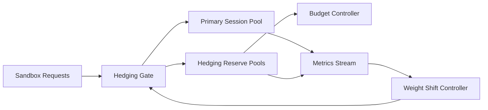

# ACA Sandbox Capacity Hedging 选型 FAQ（Cycle 1891）

## 1) 3 分钟结论
- **核心问题：** Sandbox 请求突发会导致单区域容量拥塞，触发冷启动放大与排队抖动。
- **推荐方案：** “容量对冲池 + 预算门控 + 区域权重回切”三层机制。
- **目标：** 在峰值流量下稳定会话可用性并压低尾延迟。

## 2) Q1 / Q2 / Q3
### Q1：为什么需要 capacity hedging？
1) 突发负载会突破单池弹性边界；
2) 即时扩容存在冷启动与配额延迟；
3) 仅靠重试会放大排队时间。

### Q2：生产级 capacity hedging 如何落地？
- **对冲池：** 预留跨区域/跨规格热池容量；
- **预算门控：** 依据成本预算动态限制对冲放量；
- **权重回切：** 主池恢复后按策略逐步回切，避免抖动；
- **观测闭环：** 实时跟踪命中率、回切耗时、超额成本。

### Q3：上线判据是什么？
- 峰值期间会话拒绝率显著下降；
- 尾延迟 P95 在预算内稳定；
- 对冲成本可解释且可控。

## 3) 架构图

## 4) 选型矩阵
| 维度 | 无对冲策略 | Capacity Hedging（推荐） |
|---|---:|---:|
| 峰值可用性 | 中 | 高 |
| 尾延迟稳定性 | 低 | 高 |
| 成本可控性 | 中 | 高 |
| 实施复杂度 | 低 | 中 |
| 运维可观测性 | 中 | 高 |

## 5) 证据与复算口径
- 证据文件：
  - `workshops/azure-agent-infra/evidence/cycle-1891-benchmark.json`
  - `workshops/azure-agent-infra/evidence/cycle-1891-latency.csv`
  - `workshops/azure-agent-infra/evidence/cycle-1891-throughput.csv`
  - `workshops/azure-agent-infra/evidence/cycle-1891-cost.csv`
- 标签：`measured / synthetic / anonymized_reported`。
- 校验项：FAQ 六段、CSP、cycle/topic 绑定、模拟器检查。

## 6) 生产检查清单
- [ ] 对冲池容量上限与预算阈值已定义。
- [ ] 权重回切策略经过压测与演练。
- [ ] 对冲命中率与超额成本可追踪。
- [ ] 峰值拒绝率与尾延迟目标达标。
- [ ] FAQ/H5/SVG/7-card/evidence 保持轮次一致。
