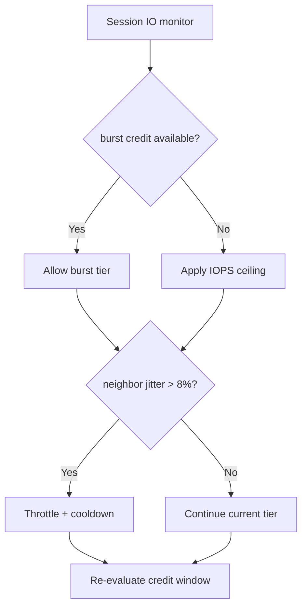
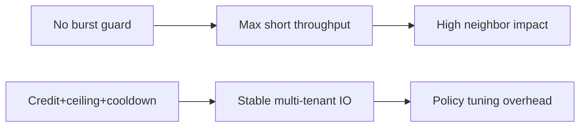
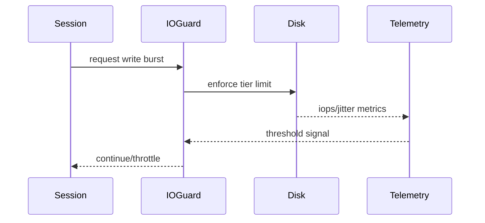

# Agent ACA Sandbox Ephemeral Disk I/O Burst Selection FAQ (Azure AI Agent Infra)

## 1) 3-minute conclusions
- **Without burst guardrails, ACA sandbox ephemeral-disk I/O spikes can destabilize neighboring sessions and tail latency.**
- **Use burst credits + per-session IOPS ceilings + cooldown fallback.**
- **Targets: `iops_burst_p95 <1.6x baseline`, `neighbor_jitter <8%`, `throttle_error <0.5%`.**

## 2) Q1 / Q2 / Q3
- **Why bursts run away?** Concurrent sessions amplify writes in the same window.
- **Why not just bigger disks?** Higher cost and still unfair contention.
- **Minimum loop?** Credit budget, session cap, cooldown recovery.

### Q1: When to throttle?
When burst credits are exhausted or neighbor jitter exceeds threshold.

### Q2: When to restore burst?
After cooldown completes and system stabilizes.

### Q3: How to measure gain?
Compare throughput availability versus neighbor impact.

## 3) Mermaid diagrams
### 3.1 Decision tree

### 3.2 Path comparison

### 3.3 Sequence

## 4) Decision matrix
| Dimension | Unguarded burst | Credit+ceiling+cooldown (Recommended) |
|---|---:|---:|
| Short throughput | High | Medium-high |
| Neighbor stability | Low | High |
| Ops complexity (1-10) | 3 | 7 |
| Cost efficiency | Medium-low | High |
| Multi-tenant fairness | Low | High |

## 5) Quant model + 7-card insights
- Jitter rate: `JitterRate = StdDevIOPS / BaselineIOPS`
- Protection gain: `NeighborGain = BaselineJitter - GuardedJitter`
- Example (`synthetic_assumed`):
  - `BaselineJitter=14.2%, GuardedJitter=6.1%`
  - `NeighborGain=8.1%`
  - `BurstP95=1.48x baseline`
- Evidence:
  - `workshops/azure-agent-infra/evidence/cycle-1477-benchmark.json`
  - `workshops/azure-agent-infra/evidence/cycle-1477-sources.json`
- Labels: `official/synthetic_assumed/not_measured`.

## 6) Production verification checklist
- [ ] Burst credits and IOPS ceilings are configurable/auditable
- [ ] Neighbor jitter alerts are wired to throttling actions
- [ ] Cooldown rollback windows are replayable
- [ ] Multi-tenant fairness reporting is traceable
- [ ] FAQ/7-card source labels are complete
