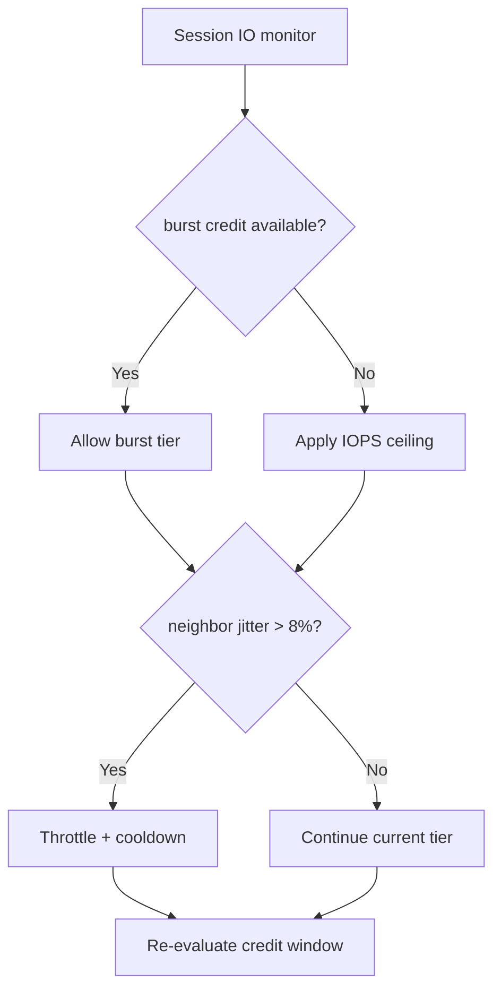
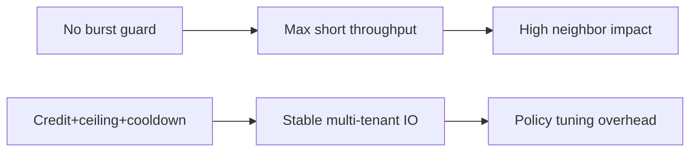
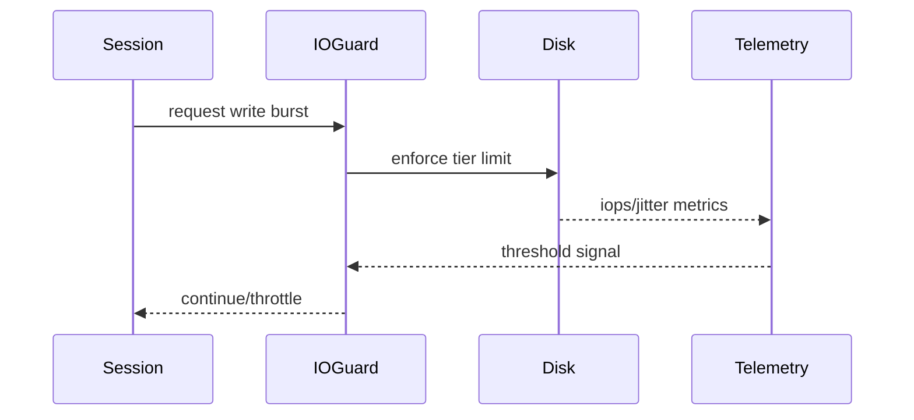

# Agent ACA Sandbox Ephemeral Disk I/O Burst 选型 FAQ（Azure AI Agent Infra）

## 1) 3 分钟结论
- **ACA 沙盒短时 I/O burst 若无配额护栏，会诱发相邻会话抖动与尾延迟飙升。**
- **推荐“burst credit 池 + 会话级 IOPS ceiling + 回落窗口”三段控制。**
- **目标阈值：`iops_burst_p95 <1.6x baseline`、`neighbor_jitter <8%`、`throttle_error <0.5%`。**

## 2) Q1 / Q2 / Q3
- **为何 burst 失控？**：多会话同窗写放大，瞬时抢占共享盘吞吐。
- **为何不能只加盘？**：成本高且不能抑制不公平竞争。
- **最小闭环？**：信用额度、会话上限、冷却回落。

### Q1：何时触发限流？
burst 信用耗尽或邻居抖动超阈值。

### Q2：何时恢复突发额度？
冷却窗口结束且系统回稳。

### Q3：如何评估收益？
比较吞吐可用性与邻居影响。

## 3) Mermaid 图
### 3.1 决策树

### 3.2 路径对比

### 3.3 时序

## 4) 决策矩阵
| 维度 | 无护栏突发 | 信用+上限+回落（推荐） |
|---|---:|---:|
| 短时吞吐 | 高 | 中高 |
| 邻居稳定性 | 低 | 高 |
| 运维复杂度（1-10） | 3 | 7 |
| 成本效率 | 中低 | 高 |
| 多租户公平 | 低 | 高 |

## 5) 定量算例与 7-Card 洞察
- 抖动率：`JitterRate = StdDevIOPS / BaselineIOPS`
- 保护收益：`NeighborGain = BaselineJitter - GuardedJitter`
- 示例（`synthetic_assumed`）：
  - `BaselineJitter=14.2%, GuardedJitter=6.1%`
  - `NeighborGain=8.1%`
  - `BurstP95=1.48x baseline`
- 证据：
  - `workshops/azure-agent-infra/evidence/cycle-1477-benchmark.json`
  - `workshops/azure-agent-infra/evidence/cycle-1477-sources.json`
- 标签：`official/synthetic_assumed/not_measured`。

## 6) 生产核验 Checklist
- [ ] burst credit 与 IOPS ceiling 可配置可审计
- [ ] 邻居抖动阈值告警联动限流
- [ ] cooldown 回落窗口可回放
- [ ] 多租户公平性报表可追踪
- [ ] FAQ/7-Card 来源标签完整
