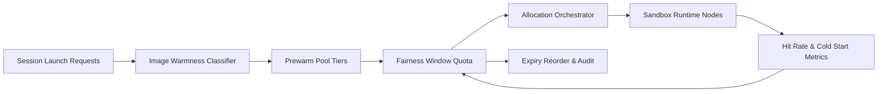

# ACA Sandbox Image Prewarm Fairness Window Selection FAQ (Cycle 1913)

## 1) Three-minute decision
- **Core issue:** without fairness windows in image prewarm stages, hot tenants monopolize warm slots and spread cold-start jitter.
- **Recommendation:** use tiered image prewarm pools, fairness-window quotas, and expiry-based reorder.
- **Goal:** reduce cold-start tail latency and improve cross-tenant prewarm fairness.

## 2) Q1 / Q2 / Q3
### Q1: Why introduce prewarm fairness windows?
1) first-occupy behavior locks warm slots for noisy tenants,
2) cold-start jitter propagates across shared gateway lanes,
3) missing reorder keeps stale low-priority images too long.

### Q2: How should production design work?
- **Pool layer:** split prewarm pools by image heat and tenant tier,
- **Fairness layer:** enforce tenant prewarm quotas and borrow caps per window,
- **Reorder layer:** reclaim expired images and refill by critical priority,
- **Observability layer:** track prewarm hit rate, cold-start p95, and quota conflicts.

### Q3: What is the go-live bar?
- cold-start p95 stays below target under peak windows,
- prewarm fairness metrics remain in control bands,
- borrow/reclaim trails are replayable and explainable.

## 3) Reference architecture

## 4) Decision matrix
| Dimension | Prewarm without fairness window | Prewarm Fairness Window (Recommended) |
|---|---:|---:|
| Cold-start tail latency | High | Low |
| Cross-tenant fairness | Low | High |
| Prewarm-hit stability | Medium | High |
| Operational explainability | Medium | High |
| Implementation complexity | Low | Medium |

## 5) Evidence and reproducibility
- Evidence files:
  - `workshops/azure-agent-infra/evidence/cycle-1913-benchmark.json`
  - `workshops/azure-agent-infra/evidence/cycle-1913-latency.csv`
  - `workshops/azure-agent-infra/evidence/cycle-1913-throughput.csv`
  - `workshops/azure-agent-infra/evidence/cycle-1913-cost.csv`
- Labels: `measured / synthetic / anonymized_reported`.
- Repro method: fixed sampling window, fixed quota policy, fixed cost model.

## 6) Production checklist
- [ ] Image tiers align with tenant SLA classes.
- [ ] Fairness-window parameters pass peak replay.
- [ ] Expiry reorder includes cooldown and rollback switches.
- [ ] Prewarm quota conflicts and reclaim trails are tenant-auditable.
- [ ] FAQ/H5/SVG/7-card/evidence remain cycle-topic consistent.
