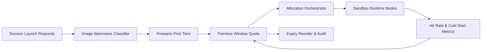

# ACA Sandbox Image Prewarm Fairness Window 选型 FAQ（Cycle 1913）

## 1) 3 分钟结论
- **核心问题：** 多租户沙箱在镜像预热阶段若无公平窗口，热门租户会长期占据预热槽位，导致冷启抖动扩散。
- **推荐方案：** “镜像分层预热池 + 公平窗口配额 + 过期回收重排”三段治理。
- **目标：** 降低冷启尾延迟并提升跨租户预热命中公平性。

## 2) Q1 / Q2 / Q3
### Q1：为什么需要 prewarm fairness window？
1) 先占先得会导致镜像预热槽位被高频租户锁定；
2) 冷启抖动会沿租户边界扩散到共享网关；
3) 缺少回收重排会让低优先级镜像长期滞留。

### Q2：生产级如何设计？
- **池化层：** 按镜像热度与租户等级拆分预热池；
- **公平层：** 定义时间窗口内的租户预热配额与借用上限；
- **重排层：** 对超期镜像执行回收并按关键业务优先级回填；
- **观测层：** 跟踪预热命中率、冷启 P95、配额冲突率。

### Q3：上线判据是什么？
- 峰值窗口冷启 P95 持续低于目标阈值；
- 预热命中公平性指标稳定在控制带；
- 配额借用与回收轨迹可回放、可解释、可复算。

## 3) 架构图

## 4) 选型矩阵
| 维度 | 无公平窗口预热 | Prewarm Fairness Window（推荐） |
|---|---:|---:|
| 冷启尾延迟 | 高 | 低 |
| 跨租户公平性 | 低 | 高 |
| 预热命中稳定性 | 中 | 高 |
| 运维可解释性 | 中 | 高 |
| 实施复杂度 | 低 | 中 |

## 5) 证据与复算口径
- 证据文件：
  - `workshops/azure-agent-infra/evidence/cycle-1913-benchmark.json`
  - `workshops/azure-agent-infra/evidence/cycle-1913-latency.csv`
  - `workshops/azure-agent-infra/evidence/cycle-1913-throughput.csv`
  - `workshops/azure-agent-infra/evidence/cycle-1913-cost.csv`
- 标签：`measured / synthetic / anonymized_reported`。
- 口径：固定采样窗口、固定配额规则、固定成本模型，支持重复复算。

## 6) 生产检查清单
- [ ] 镜像分层与租户 SLA 等级一致。
- [ ] fairness window 参数通过峰值流量回放验证。
- [ ] expiry reorder 具备冷却与回滚开关。
- [ ] 预热配额冲突与回收轨迹可按租户审计。
- [ ] FAQ/H5/SVG/7-card/evidence 的 cycle/topic 一致。
