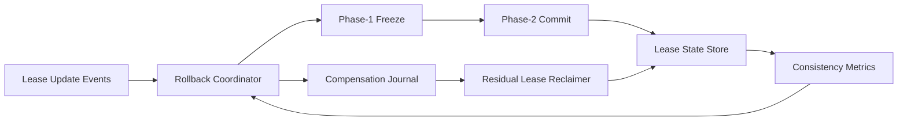

# ACA Sandbox Lease Rollback Coordinator Selection FAQ (Cycle 1904)

## 1) Three-minute decision
- **Core issue:** without a unified rollback coordinator, lease-policy rollback can create partial rollback and residual lease failures.
- **Recommendation:** combine rollback coordination, two-phase confirmation, and residual compensation cleanup.
- **Goal:** maintain lease-state consistency and predictable session recovery during rollback windows.

## 2) Q1 / Q2 / Q3
### Q1: Why does lease rollback need a dedicated coordinator?
1) parallel component rollback has ordering races,
2) single failures can leave orphan leases,
3) inconsistent state keeps consuming pool capacity.

### Q2: How should production rollback coordination be designed?
- **Two-phase confirmation:** freeze lease mutations before commit decision,
- **Compensation journal:** persist each step for replay and recovery,
- **Residual cleanup:** periodically reclaim orphan leases,
- **Policy guardrails:** switch to conservative mode on timeout and limit new renewals.

### Q3: What is the go-live bar?
- lower lease-consistency errors during rollback,
- bounded orphan-lease cleanup latency,
- fast session-success recovery after rollback.

## 3) Reference architecture

## 4) Decision matrix
| Dimension | Uncoordinated rollback | Rollback Coordinator (Recommended) |
|---|---:|---:|
| State consistency | Low | High |
| Rollback predictability | Low | High |
| Orphan-lease control | Low | High |
| Implementation complexity | Low | Medium |
| Operational auditability | Medium | High |

## 5) Evidence and reproducibility
- Evidence files:
  - `workshops/azure-agent-infra/evidence/cycle-1904-benchmark.json`
  - `workshops/azure-agent-infra/evidence/cycle-1904-latency.csv`
  - `workshops/azure-agent-infra/evidence/cycle-1904-throughput.csv`
  - `workshops/azure-agent-infra/evidence/cycle-1904-policy.csv`
- Labels: `measured / synthetic / anonymized_reported`.
- Validation chain: six-part FAQ, CSP, cycle/topic binding, simulator checks.

## 6) Production checklist
- [ ] Two-phase rollback protocol passes fault-injection tests.
- [ ] Compensation journal is replayable and idempotent.
- [ ] Orphan-lease cleanup has alerting and rollback switches.
- [ ] Conservative-mode thresholds are integrated with renewal gating.
- [ ] FAQ/H5/SVG/7-card/evidence remain cycle-consistent.
