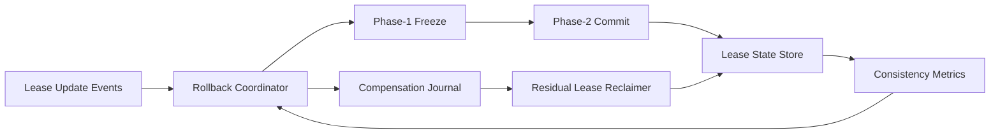

# ACA Sandbox Lease Rollback Coordinator 选型 FAQ（Cycle 1904）

## 1) 3 分钟结论
- **核心问题：** 会话租约策略在异常回滚时若缺少统一协调器，容易导致“部分回滚+残留租约”并发故障。
- **推荐方案：** “租约回滚协调器 + 双阶段确认 + 残留清理补偿”闭环。
- **目标：** 在故障回滚窗口中保证租约状态一致、会话恢复可预测。

## 2) Q1 / Q2 / Q3
### Q1：为什么 lease rollback 需要专门协调器？
1) 多组件并行回滚存在时序竞争；
2) 单点失败会留下孤儿租约；
3) 不一致状态会持续消耗池容量。

### Q2：生产级 rollback coordinator 如何设计？
- **双阶段确认：** 先冻结租约变更，再提交回滚决议；
- **补偿日志：** 记录每一步变更用于重放与恢复；
- **残留清理：** 定时扫描孤儿租约并执行补偿回收；
- **策略护栏：** 超时回滚进入保守模式，限制新续租。

### Q3：上线判据是什么？
- 回滚期间租约一致性错误显著下降；
- 孤儿租约清理延迟在阈值内；
- 回滚后会话成功率快速恢复。

## 3) 架构图

## 4) 选型矩阵
| 维度 | 无协调回滚 | Rollback Coordinator（推荐） |
|---|---:|---:|
| 状态一致性 | 低 | 高 |
| 回滚可预测性 | 低 | 高 |
| 孤儿租约治理 | 低 | 高 |
| 实施复杂度 | 低 | 中 |
| 运维审计能力 | 中 | 高 |

## 5) 证据与复算口径
- 证据文件：
  - `workshops/azure-agent-infra/evidence/cycle-1904-benchmark.json`
  - `workshops/azure-agent-infra/evidence/cycle-1904-latency.csv`
  - `workshops/azure-agent-infra/evidence/cycle-1904-throughput.csv`
  - `workshops/azure-agent-infra/evidence/cycle-1904-policy.csv`
- 标签：`measured / synthetic / anonymized_reported`。
- 校验链：FAQ 六段、CSP、cycle/topic 绑定、模拟器检查。

## 6) 生产检查清单
- [ ] 双阶段回滚协议通过故障注入测试。
- [ ] 补偿日志可重放且具备幂等性。
- [ ] 孤儿租约清理任务有告警与回滚开关。
- [ ] 保守模式阈值与新续租门控联调完成。
- [ ] FAQ/H5/SVG/7-card/evidence 轮次一致。
