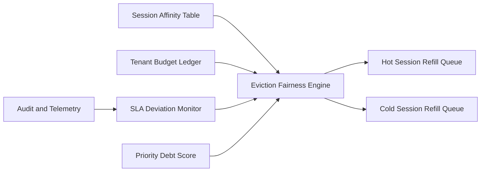

# ACA Session Affinity Eviction Fairness Selection FAQ (Cycle 1874)

## 1) Three-minute decision
- **Core issue:** session affinity improves continuity, but unfair eviction causes tenant imbalance and SLA jitter.
- **Recommendation:** combine affinity-retention budgets, fairness-aware eviction queues, and hot/cold refill tiers.
- **Goal:** preserve session continuity while enforcing multi-tenant fairness and stable recovery.

## 2) Q1 / Q2 / Q3
### Q1: Why is pure LRU eviction insufficient?
1) high-frequency tenants monopolize hot capacity,
2) low-frequency but high-value sessions can be evicted too early,
3) peak events need explicit tenant fairness constraints.

### Q2: How should production eviction fairness be implemented?
- **Retention budgets:** minimum affinity retention quotas per tenant,
- **Fair queues:** rank eviction by tenant debt score plus session value,
- **Hot/cold refill:** prioritize hot-session refill and delay cold recovery,
- **Feedback loop:** adjust eviction weights by SLA deviation signals.

### Q3: What is the go-live bar?
- reduced variance in cross-tenant eviction rates,
- session recovery P95 stays within target,
- key-tenant SLA deviation remains below threshold.

## 3) Reference architecture

## 4) Decision matrix
| Dimension | LRU eviction | Affinity fairness eviction (Recommended) |
|---|---:|---:|
| Multi-tenant fairness | Low | High |
| Session continuity | Medium | High |
| Peak stability | Low | High |
| Implementation complexity | Low | Medium |
| SLA controllability | Medium | High |

## 5) Evidence and reproducibility
- Evidence files:
  - `workshops/azure-agent-infra/evidence/cycle-1874-benchmark.json`
  - `workshops/azure-agent-infra/evidence/cycle-1874-latency.csv`
  - `workshops/azure-agent-infra/evidence/cycle-1874-throughput.csv`
  - `workshops/azure-agent-infra/evidence/cycle-1874-policy.csv`
- Labels: `measured / synthetic / anonymized_reported`.
- validation7 enforces six-part structure, CSP-safe 7-card output, strict cycle-topic alignment, and replayable checks.

## 6) Production checklist
- [ ] Tenant affinity retention budgets are configured.
- [ ] Fair-eviction queue scoring passes load tests.
- [ ] Hot/cold refill strategy passes failure drills.
- [ ] SLA deviation feedback loop is integrated.
- [ ] FAQ/H5/SVG/7-card/evidence remain cycle-consistent.
