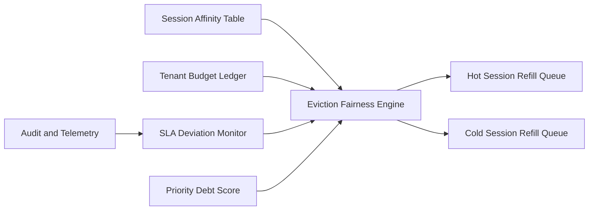

# ACA Session Affinity Eviction Fairness 选型 FAQ（Cycle 1874）

## 1) 3 分钟结论
- **核心问题：** 会话亲和提升连续性，但不公平驱逐会造成租户间资源倾斜与 SLA 抖动。
- **推荐方案：** “亲和保留预算 + 公平驱逐队列 + 冷热分层回补”。
- **目标：** 在保持会话连续体验的同时，实现多租户资源公平与稳定恢复。

## 2) Q1 / Q2 / Q3
### Q1：为什么只按最近访问时间驱逐会失衡？
1) 高频租户会长期占据热点资源；
2) 低频但高价值会话可能被过早回收；
3) 峰值时缺少租户公平约束。

### Q2：生产级 eviction fairness 应如何实现？
- **保留预算：** 每租户设置最小亲和保留配额；
- **公平队列：** 驱逐决策按租户债务分与会话价值联合排序；
- **冷热回补：** 热会话优先回补，冷会话延迟恢复；
- **观测反馈：** 以租户 SLA 偏差回调驱逐权重。

### Q3：上线判据是什么？
- 租户间驱逐率方差显著收敛；
- 会话恢复 P95 在目标范围内；
- 关键租户 SLA 偏差未超阈值。

## 3) 架构图

## 4) 选型矩阵
| 维度 | LRU 驱逐 | 亲和公平驱逐（推荐） |
|---|---:|---:|
| 多租户公平性 | 低 | 高 |
| 会话连续性 | 中 | 高 |
| 峰值稳定性 | 低 | 高 |
| 实施复杂度 | 低 | 中 |
| SLA 可控性 | 中 | 高 |

## 5) 证据与复算口径
- 证据文件：
  - `workshops/azure-agent-infra/evidence/cycle-1874-benchmark.json`
  - `workshops/azure-agent-infra/evidence/cycle-1874-latency.csv`
  - `workshops/azure-agent-infra/evidence/cycle-1874-throughput.csv`
  - `workshops/azure-agent-infra/evidence/cycle-1874-policy.csv`
- 标签：`measured / synthetic / anonymized_reported`。
- validation7：六段结构、7-card CSP、cycle-topic 对齐、验证链可回放。

## 6) 生产检查清单
- [ ] 租户亲和保留预算策略配置完成。
- [ ] 公平驱逐队列评分规则压测通过。
- [ ] 冷热回补策略完成故障演练。
- [ ] SLA 偏差反馈回路联调通过。
- [ ] FAQ/H5/SVG/7-card/evidence 轮次一致。
