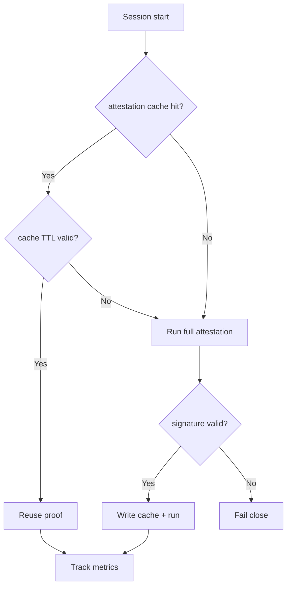
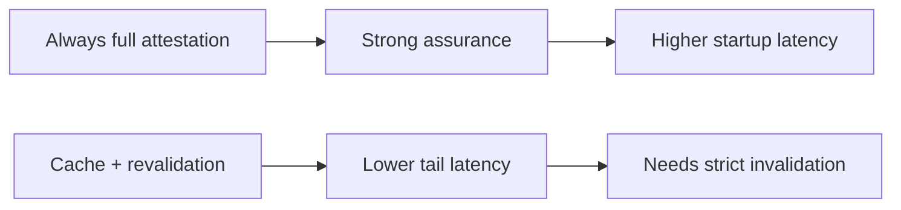
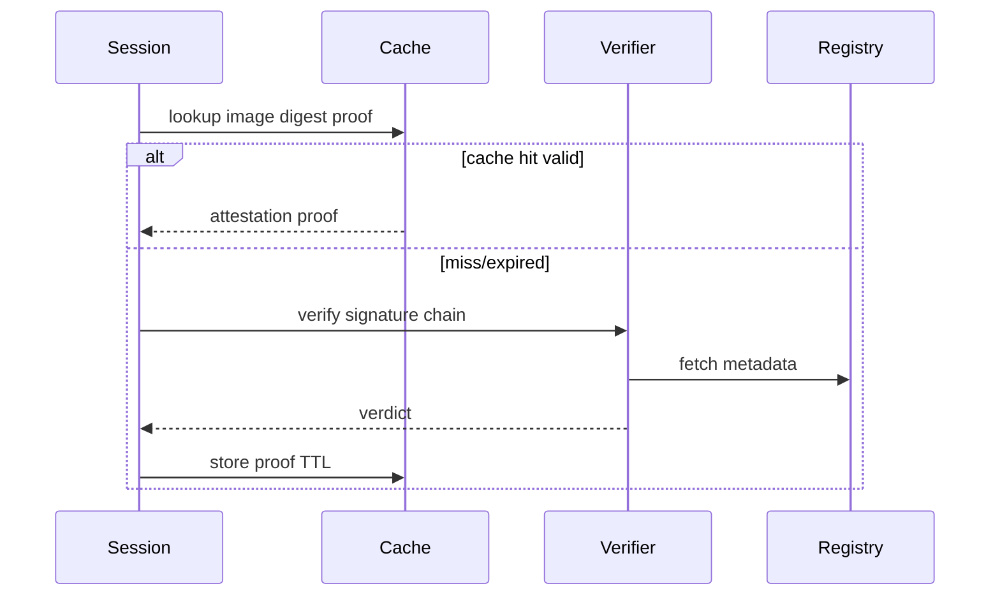

# Agent ACA Session Image Attestation Cache Selection FAQ (Azure AI Agent Infra)

## 1) 3-minute conclusions
- **In ACA Dynamic Sessions, full-chain image attestation on every session can inflate cold-start tails.**
- **Use attestation proof cache + TTL + cert-rotation invalidation to balance security and startup latency.**
- **Targets: `cold_start_p95 <14s`, `attestation_fail_open=0`, `cache_stale_hit <0.1%`.**

## 2) Q1 / Q2 / Q3
- **Why slow?** Every session fetches and verifies full provenance remotely.
- **Why cache is acceptable?** Signature digest + cert chain are reusable within strict TTL.
- **Minimum loop?** Signature check, cache hit policy, rotation invalidation, forced re-verify.

### Q1: When must re-verify be forced?
During cert rotation, signature version upgrades, or unusual hit anomalies.

### Q2: When must fail-close apply?
When cache misses and upstream verification is unavailable.

### Q3: How to quantify gain?
Compare tail-latency reduction versus false-allow risk.

## 3) Mermaid diagrams
### 3.1 Decision tree

### 3.2 Path comparison

### 3.3 Sequence

## 4) Decision matrix
| Dimension | Full verification each run | Cache + re-verify (Recommended) |
|---|---:|---:|
| Startup latency | Lower score | Higher score |
| Security certainty | High | High |
| Ops complexity (1-10) | 4 | 7 |
| Cert rotation readiness | Medium | High |
| Cost efficiency | Medium | High |

## 5) Quant model + 7-card insights
- Latency gain: `LatencyGain = BaselineP95 - CachedP95`
- Stale risk: `StaleRisk = StaleHits / TotalCacheHits`
- Example (`synthetic_assumed`):
  - `BaselineP95=21.4s, CachedP95=13.2s`
  - `LatencyGain=8.2s`
  - `StaleHits=7, TotalCacheHits=12,400`
  - `StaleRisk=0.056%`
- Evidence:
  - `workshops/azure-agent-infra/evidence/cycle-1471-benchmark.json`
  - `workshops/azure-agent-infra/evidence/cycle-1471-sources.json`
- Labels: `official/synthetic_assumed/not_measured`.

## 6) Production verification checklist
- [ ] Signature and cert-chain verification are auditable
- [ ] Cache TTL/invalidation policies are versioned
- [ ] Rotation events trigger forced re-verification
- [ ] Fail-close path load test passed
- [ ] FAQ/7-card source labels are complete
