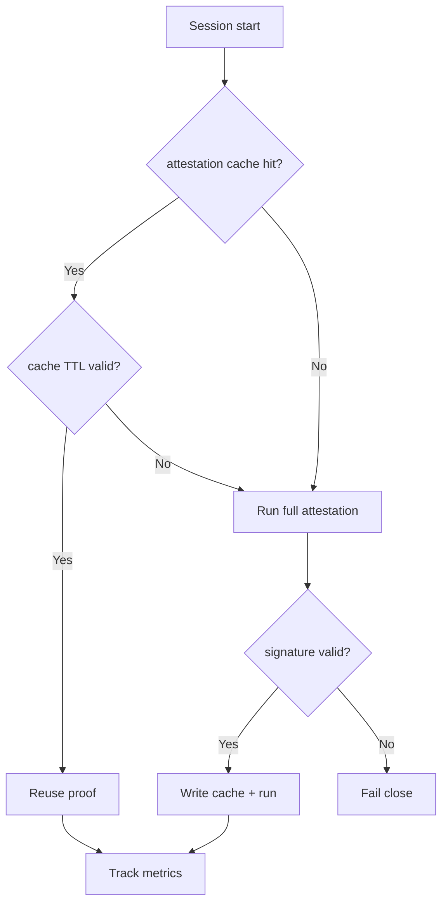
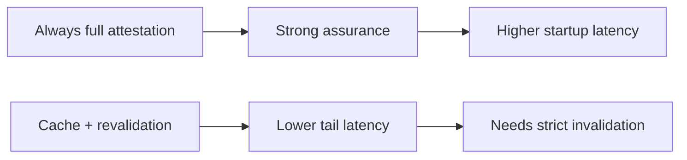
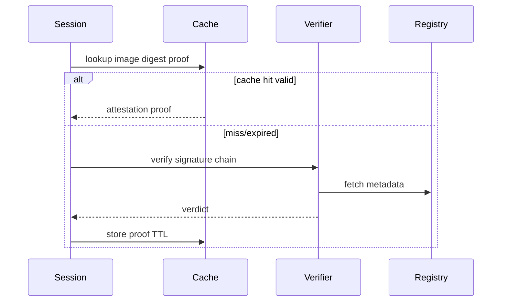

# Agent ACA Session Image Attestation Cache 选型 FAQ（Azure AI Agent Infra）

## 1) 3 分钟结论
- **ACA Dynamic Sessions 场景里，镜像签名验真若每次全链路校验会显著拉高冷启动。**
- **推荐“签名证明缓存 + TTL + 证书轮换失效”组合，兼顾安全与启动时间。**
- **目标阈值：`cold_start_p95 <14s`、`attestation_fail_open=0`、`cache_stale_hit <0.1%`。**

## 2) Q1 / Q2 / Q3
- **为什么会慢？**：每次会话都远程拉取并校验证明。
- **为什么能缓存？**：签名摘要与证书链可按 TTL 短期复用。
- **最小闭环？**：签名校验、缓存命中、轮换失效、强制重验。

### Q1：何时必须强制重验？
证书轮换、签名版本升级、命中异常增长时。

### Q2：何时允许 fail-close？
当缓存 miss 且上游验证不可用。

### Q3：收益如何量化？
比较冷启动尾延迟下降和安全误放行风险。

## 3) Mermaid 图
### 3.1 决策树

### 3.2 路径对比

### 3.3 时序

## 4) 决策矩阵
| 维度 | 全量每次验签 | 缓存+重验（推荐） |
|---|---:|---:|
| 启动时延 | 低分 | 高分 |
| 安全确定性 | 高 | 高 |
| 运维复杂度（1-10） | 4 | 7 |
| 证书轮换适应性 | 中 | 高 |
| 成本效率 | 中 | 高 |

## 5) 定量算例与 7-Card 洞察
- 时延收益：`LatencyGain = BaselineP95 - CachedP95`
- 失效风险：`StaleRisk = StaleHits / TotalCacheHits`
- 示例（`synthetic_assumed`）：
  - `BaselineP95=21.4s, CachedP95=13.2s`
  - `LatencyGain=8.2s`
  - `StaleHits=7, TotalCacheHits=12,400`
  - `StaleRisk=0.056%`
- 证据：
  - `workshops/azure-agent-infra/evidence/cycle-1471-benchmark.json`
  - `workshops/azure-agent-infra/evidence/cycle-1471-sources.json`
- 标签：`official/synthetic_assumed/not_measured`。

## 6) 生产核验 Checklist
- [ ] 签名校验与证书链验证可审计
- [ ] attestation cache TTL 与失效规则版本化
- [ ] 轮换事件触发强制重验路径
- [ ] fail-close 路径压测通过
- [ ] FAQ/7-Card 来源标签完整
