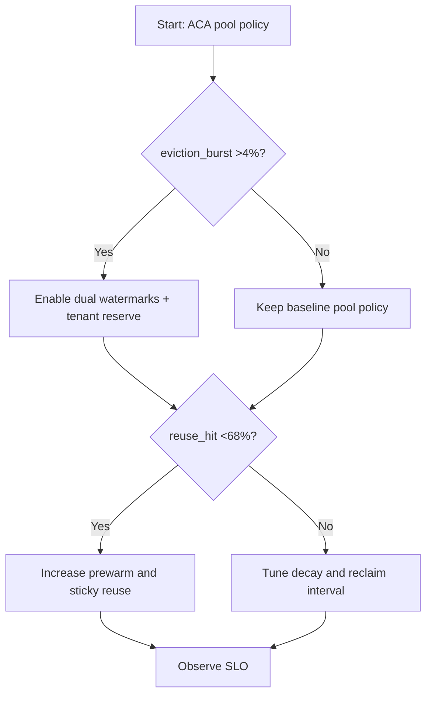
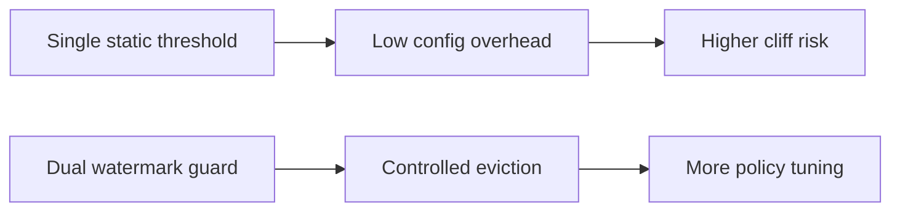
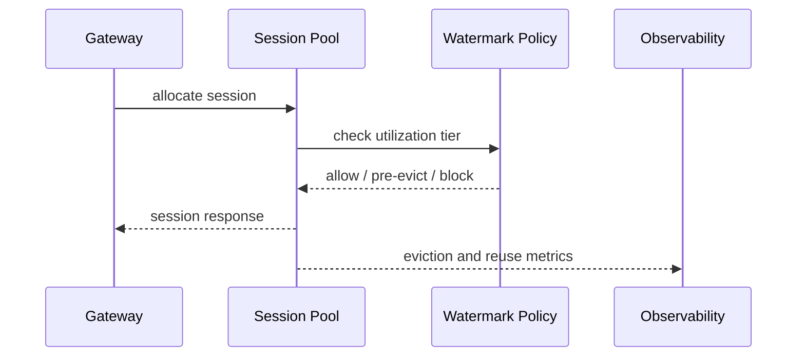

# Agent ACA Session Pool Eviction Watermark Guard Selection FAQ (Azure AI Agent Infra)

## 1) 3-minute conclusions
- **If session-pool eviction bursts exceed 4% and reuse hit-rate drops below 68%, enable dual-watermark tiers with tenant reserves.**
- **Fix watermark governance before scaling instances; scale-only defers instability.**
- **Targets: `high_watermark<=82%`, `critical_watermark<=92%`, eviction recovery P95 <90s.**

## 2) Q1 / Q2 / Q3
- **Why sudden mass evictions?** Burst load with one-dimensional reclaim policy.
- **Why watermarks help?** They tier preemption decisions before cliff points.
- **Minimum loop?** Watermark tiers, tenant priority, eviction replay checks.

### Q1: When are dual watermarks mandatory?
When CPU or memory exceeds 82% in 5-minute windows and eviction events continue rising.

### Q2: When are static thresholds enough?
Low-concurrency single-tenant test environments.

### Q3: How to measure payoff?
Compare failed-request reduction from eviction control against added prewarm cost.

## 3) Mermaid diagrams
### 3.1 Decision tree

### 3.2 Path comparison

### 3.3 Sequence

## 4) Decision matrix
| Dimension | Static threshold | Dual-watermark guard (Recommended) |
|---|---:|---:|
| Eviction burst rate | 2.1%–6.4% | 0.6%–2.2% |
| Session reuse hit | 55%–73% | 68%–84% |
| Ops complexity (1-10) | 4 | 7 |
| Peak stability | Medium | High |

## 5) Quant model + 7-card insights
- Eviction pressure: `EvictPressure = EvictedSessions / TotalSessions`
- Recovery gain: `RecoveryGain = BaselineFailure - NewFailure`
- Example (`synthetic_assumed`):
  - `EvictedSessions=1,240, TotalSessions=28,000`
  - `EvictPressure=4.43%`
  - `BaselineFailure=2.8%, NewFailure=1.1%`
  - `RecoveryGain=1.7pp`
- Evidence:
  - `workshops/azure-agent-infra/evidence/cycle-1459-benchmark.json`
  - `workshops/azure-agent-infra/evidence/cycle-1459-sources.json`
- Labels: `official/synthetic_assumed/not_measured`.

## 6) Production verification checklist
- [ ] Dual watermarks and tenant-priority policy are active
- [ ] Eviction replay tests cover burst periods
- [ ] Reuse-hit and recovery alerts are configured
- [ ] FAQ/7-card source labels are complete
