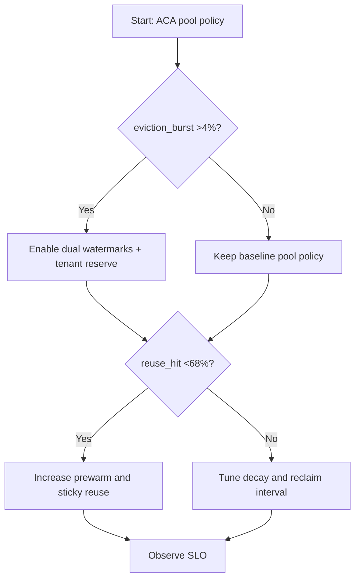
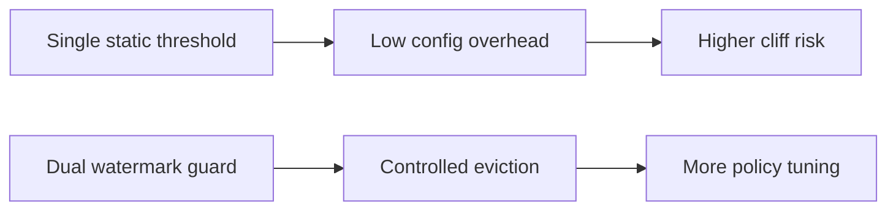
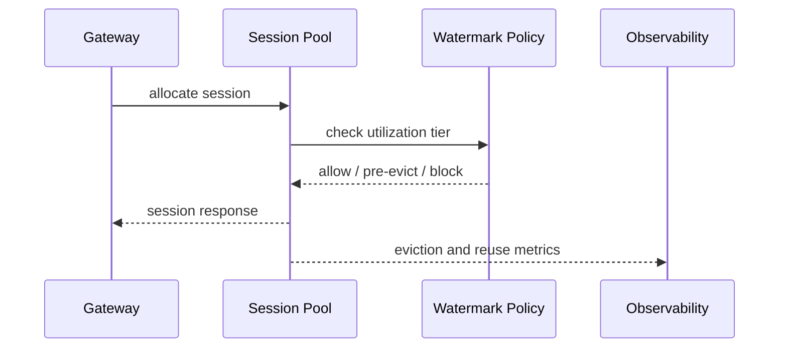

# Agent ACA Session Pool Eviction Watermark Guard 选型 FAQ（Azure AI Agent Infra）

## 1) 3 分钟结论
- **当会话池逐出突发率 >4% 且复用命中率 <68% 时，必须启用分级水位线与租户保护配额。**
- **先做水位线治理，再扩容实例；仅扩容会把抖动推迟而不会消失。**
- **生产阈值：`high_watermark<=82%`、`critical_watermark<=92%`、逐出恢复时间 P95 <90s。**

## 2) Q1 / Q2 / Q3
- **为什么会突然大量逐出？**：负载瞬时突增 + 池内回收策略单一。
- **为什么水位线有效？**：把抢占决策提前并分层，避免临界点雪崩。
- **最小闭环？**：水位分级、租户优先级、逐出回放验证。

### Q1：什么时候必须启用双水位线？
当 CPU/内存任一指标在 5 分钟窗口内超过 82% 且逐出事件持续增长。

### Q2：什么时候可只用静态阈值？
低并发、单租户、无突发流量的测试环境。

### Q3：如何量化收益？
比较逐出失败请求下降率与新增热池成本。

## 3) Mermaid 图
### 3.1 决策树

### 3.2 路径对比

### 3.3 时序

## 4) 决策矩阵
| 维度 | 静态阈值 | 双水位线守护（推荐） |
|---|---:|---:|
| 逐出突发率 | 2.1%–6.4% | 0.6%–2.2% |
| 会话复用命中 | 55%–73% | 68%–84% |
| 运维复杂度（1-10） | 4 | 7 |
| 高峰稳定性 | 中 | 高 |

## 5) 定量算例与 7-Card 洞察
- 逐出压力：`EvictPressure = EvictedSessions / TotalSessions`
- 恢复收益：`RecoveryGain = BaselineFailure - NewFailure`
- 示例（`synthetic_assumed`）：
  - `EvictedSessions=1,240, TotalSessions=28,000`
  - `EvictPressure=4.43%`
  - `BaselineFailure=2.8%, NewFailure=1.1%`
  - `RecoveryGain=1.7pp`
- 证据：
  - `workshops/azure-agent-infra/evidence/cycle-1459-benchmark.json`
  - `workshops/azure-agent-infra/evidence/cycle-1459-sources.json`
- 标签：`official/synthetic_assumed/not_measured`。

## 6) 生产核验 Checklist
- [ ] 双水位与租户优先级策略已生效
- [ ] 逐出回放验证覆盖高峰流量
- [ ] 复用命中与逐出恢复告警阈值上线
- [ ] FAQ/7-Card 来源标签完整
