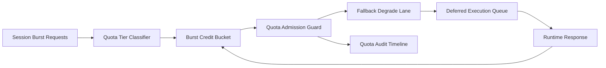

# ACA Session Quota Burst Credit Fairness Selection FAQ (Cycle 1919)

## 1) Three-minute decision
- **Core issue:** under burst traffic, session quota without credit buckets and fairness tiers causes persistent starvation and timeout spikes for low-weight tenants.
- **Recommendation:** combine session quota tiering, burst credit buckets, and overflow fallback degradation.
- **Goal:** preserve stable recovery for key tenants and reduce queue-tail latency under burst.

## 2) Q1 / Q2 / Q3
### Q1: Why enforce burst credit fairness?
1) static-only quotas amplify noisy-tenant dominance during burst,
2) without credit buckets, short spikes become cascading timeouts,
3) without fallback lanes, over-quota requests fail outright.

### Q2: How should production design work?
- **Tier layer:** classify session quota tiers by tenant+tier+workload,
- **Credit layer:** apply per-tier burst credit buckets with refill cadence,
- **Fallback layer:** route over-quota calls to degraded model or deferred queue,
- **Audit layer:** persist deny/degrade/recover traces by tenant.

### Q3: What is the go-live bar?
- lower unfair-quota and timeout rates,
- stable throughput across burst windows,
- replayable and auditable quota/fallback decisions.

## 3) Reference architecture

## 4) Decision matrix
| Dimension | Static quota + first-come | Burst Credit Fairness (Recommended) |
|---|---:|---:|
| Multi-tenant fairness | Low | High |
| Peak stability | Medium | High |
| Timeout suppression | Medium | High |
| Operational explainability | Medium | High |
| Implementation complexity | Low | Medium |

## 5) Evidence and reproducibility
- Evidence files:
  - `workshops/azure-agent-infra/evidence/cycle-1919-benchmark.json`
  - `workshops/azure-agent-infra/evidence/cycle-1919-latency.csv`
  - `workshops/azure-agent-infra/evidence/cycle-1919-throughput.csv`
  - `workshops/azure-agent-infra/evidence/cycle-1919-cost.csv`
- Labels: `measured / synthetic / anonymized_reported`.
- Repro method: fixed sampling window, fixed burst-credit policy, fixed cost model.

## 6) Production checklist
- [ ] Quota tiering aligns with tenant boundaries.
- [ ] Burst credit parameters pass historical replay verification.
- [ ] Overflow fallback includes cooldown and rollback switches.
- [ ] Deny/degrade/recover trails are tenant-auditable.
- [ ] FAQ/H5/SVG/7-card/evidence remain cycle-topic consistent.
