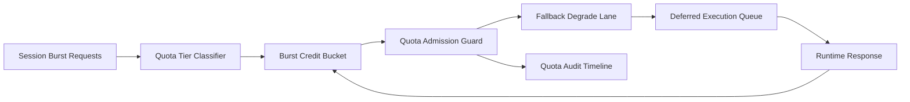

# ACA Session Quota Burst Credit Fairness 选型 FAQ（Cycle 1919）

## 1) 3 分钟结论
- **核心问题：** 动态会话在流量突发时，若配额缺少信用桶与公平分层，低权重租户会被持续挤压并触发超时。
- **推荐方案：** “会话配额分层 + Burst Credit 桶 + 超额降级回退”三层治理。
- **目标：** 保持关键租户稳定恢复并降低突发排队长尾。

## 2) Q1 / Q2 / Q3
### Q1：为什么要做 burst credit fairness？
1) 纯静态配额在突发流量下会放大噪声租户占用；
2) 无信用桶时，短时洪峰直接转化为级联超时；
3) 无降级回退路径会让超额请求全部失败。

### Q2：生产级如何设计？
- **分层层：** 按 tenant+tier+workload 划分会话配额层；
- **信用层：** 每层配置 burst credit 桶与补充节奏；
- **回退层：** 超额请求走降级模型或延迟执行队列；
- **审计层：** 记录超额拒绝、降级命中与恢复轨迹。

### Q3：上线判据是什么？
- 配额不公平率与超时率持续下降；
- 高峰窗口内吞吐保持稳定；
- 配额决策与回退动作可审计可复算。

## 3) 架构图

## 4) 选型矩阵
| 维度 | 静态配额 + 先到先得 | Burst Credit Fairness（推荐） |
|---|---:|---:|
| 多租户公平性 | 低 | 高 |
| 峰值稳定性 | 中 | 高 |
| 超时抑制能力 | 中 | 高 |
| 运维可解释性 | 中 | 高 |
| 实施复杂度 | 低 | 中 |

## 5) 证据与复算口径
- 证据文件：
  - `workshops/azure-agent-infra/evidence/cycle-1919-benchmark.json`
  - `workshops/azure-agent-infra/evidence/cycle-1919-latency.csv`
  - `workshops/azure-agent-infra/evidence/cycle-1919-throughput.csv`
  - `workshops/azure-agent-infra/evidence/cycle-1919-cost.csv`
- 标签：`measured / synthetic / anonymized_reported`。
- 口径：固定采样窗口、固定 burst credit 策略、固定成本模型，支持重复复算。

## 6) 生产检查清单
- [ ] 配额分层规则与租户边界一致。
- [ ] Burst credit 参数通过历史回放验证。
- [ ] 超额回退具备冷却与回滚开关。
- [ ] 拒绝/降级/恢复轨迹可按租户审计。
- [ ] FAQ/H5/SVG/7-card/evidence 的 cycle/topic 一致。
