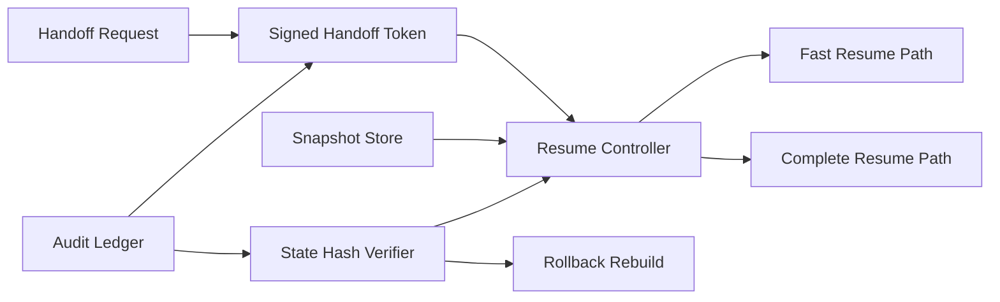

# ACA Session Resume Handoff Selection FAQ (Cycle 1849)

## 1) Three-minute decision
- **Core tradeoff:** frequent session handoffs demand fast resume, but broad context replay increases state contamination and privilege carryover risk.
- **Recommendation:** minimal resume snapshots, signed handoff-token validation, and tiered resume paths (fast vs complete).
- **Goal:** preserve low-latency handoff while maintaining correctness and permission boundaries.

## 2) Q1 / Q2 / Q3
### Q1: Why is full-context replay unsustainable?
1) context size grows and resume latency drifts upward,
2) stale state leaks into resumed execution,
3) excess permission context increases boundary-cross risk.

### Q2: What production-grade session-resume handoff model should be used?
- **Minimal snapshot:** keep only critical task state, policy version, and handles,
- **Handoff token:** signed, tenant/task scoped, and time-bounded to prevent replay,
- **Tiered resume:** fast core-state restore followed by async long-tail hydration,
- **Consistency check:** post-resume state-hash verification with rollback rebuild on mismatch.

### Q3: How do we validate fast and correct resume?
- lower P95 resume latency,
- higher post-resume success and first-turn correctness,
- bounded privilege and replay alert rates.

## 3) Reference architecture

## 4) Decision matrix
| Dimension | Full-context replay | Minimal-snapshot tiered resume (Recommended) |
|---|---:|---:|
| Resume latency | Low | High |
| Resume correctness | Medium | High |
| Permission-boundary safety | Low | High |
| Implementation complexity | Low | Medium |
| Auditability | Medium | High |

## 5) Evidence and reproducibility
- Evidence files:
  - `workshops/azure-agent-infra/evidence/cycle-1849-benchmark.json`
  - `workshops/azure-agent-infra/evidence/cycle-1849-latency.csv`
  - `workshops/azure-agent-infra/evidence/cycle-1849-throughput.csv`
  - `workshops/azure-agent-infra/evidence/cycle-1849-policy.csv`
- Labels: `measured / synthetic / anonymized_reported`.
- validation7 enforces bilingual six-part structure, CSP self-contained 7-card output, strict cycle-evidence alignment, and replayability.

## 6) Production checklist
- [ ] Minimal snapshot schema is frozen and versioned.
- [ ] Handoff-token signature, expiry, and anti-replay controls are active.
- [ ] Fast and complete resume paths are observable.
- [ ] Post-resume consistency checks and rollback drills pass.
- [ ] FAQ/H5/SVG/7-card align with cycle evidence.
