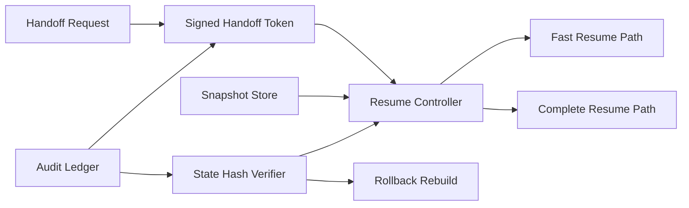

# ACA Session Resume 交接恢复选型 FAQ（Cycle 1849）

## 1) 3 分钟结论
- **核心矛盾：** 会话切换与任务交接越频繁，恢复速度越关键；但恢复上下文过宽会带来状态污染与权限串联风险。
- **推荐：** 最小恢复快照 + 交接令牌校验 + 分层恢复路径（快速恢复/完整恢复）。
- **目标：** 在跨会话接力时兼顾恢复时延、正确性与权限边界。

## 2) Q1 / Q2 / Q3
### Q1：为什么“全量上下文恢复”不可持续？
1) 上下文体量膨胀，恢复时延随轮次增长；
2) 过期状态混入导致执行偏差；
3) 跨任务携带多余权限信息增加越界风险。

### Q2：生产级 Session Resume 交接应如何设计？
- **最小快照：** 仅保留任务关键状态、策略版本与资源句柄；
- **交接令牌：** 绑定租户、任务、时效与签名，防止重放；
- **分层恢复：** 先快速恢复核心状态，再异步回补长尾上下文；
- **一致性校验：** 恢复后执行状态哈希核对，不一致则回滚重建。

### Q3：如何验证恢复链路“快且准”？
- 恢复 P95 时延下降；
- 恢复后任务成功率与首轮正确率提升；
- 越权与重放告警率受控。

## 3) 架构图

## 4) 选型矩阵
| 维度 | 全量同步恢复 | 最小快照分层恢复（推荐） |
|---|---:|---:|
| 恢复时延 | 低 | 高 |
| 恢复正确性 | 中 | 高 |
| 权限边界安全 | 低 | 高 |
| 实施复杂度 | 低 | 中 |
| 可审计性 | 中 | 高 |

## 5) 证据与复算口径
- 证据文件：
  - `workshops/azure-agent-infra/evidence/cycle-1849-benchmark.json`
  - `workshops/azure-agent-infra/evidence/cycle-1849-latency.csv`
  - `workshops/azure-agent-infra/evidence/cycle-1849-throughput.csv`
  - `workshops/azure-agent-infra/evidence/cycle-1849-policy.csv`
- 标签：`measured / synthetic / anonymized_reported`。
- validation7：双语六段结构、7-card CSP 自包含、轮次与 evidence 一致、可回放链路通过。

## 6) 生产检查清单
- [ ] 最小恢复快照字段已冻结并版本化。
- [ ] 交接令牌签名、时效与重放防护生效。
- [ ] 快速/完整恢复双路径可观测。
- [ ] 恢复后一致性校验与回滚链路演练通过。
- [ ] FAQ/H5/SVG/7-card 与 evidence 轮次一致。
