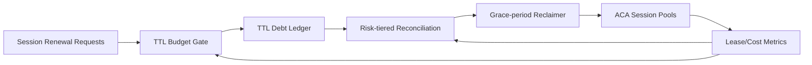

# ACA Session TTL Debt Reconciliation Selection FAQ (Cycle 1900)

## 1) Three-minute decision
- **Core issue:** frequent TTL renewals during peak protection can accumulate lease debt and delay reclaim if no reconciliation model exists.
- **Recommendation:** combine TTL debt ledgering, tiered renewal budgets, and graded reclaim grace windows.
- **Goal:** preserve critical session continuity without allowing renewal debt to erode pool capacity.

## 2) Q1 / Q2 / Q3
### Q1: Why does TTL renewal create debt risk?
1) peak protection extends many sessions at once,
2) without reconciliation historical renewals persist,
3) compressed reclaim windows inflate later cold-start cost.

### Q2: How should production TTL debt reconciliation be designed?
- **Debt ledger:** track every renewal amount, reason, tenant, and time window,
- **Tiered budgets:** separate renewal caps for critical vs regular sessions,
- **Grace gradient:** reclaim in risk-tiered batches at expiry,
- **Policy loop:** tighten renewal thresholds based on debt balance.

### Q3: What is the go-live bar?
- debt balance oscillates within controlled bounds,
- reclaim success and session success both meet targets,
- cold-start cost does not regress due to reclaim policy.

## 3) Reference architecture

## 4) Decision matrix
| Dimension | Renewal without reconciliation | TTL Debt Reconciliation (Recommended) |
|---|---:|---:|
| Resource reclaimability | Low | High |
| Session continuity | Medium | High |
| Cost stability | Low | High |
| Implementation complexity | Low | Medium |
| Governance explainability | Medium | High |

## 5) Evidence and reproducibility
- Evidence files:
  - `workshops/azure-agent-infra/evidence/cycle-1900-benchmark.json`
  - `workshops/azure-agent-infra/evidence/cycle-1900-latency.csv`
  - `workshops/azure-agent-infra/evidence/cycle-1900-throughput.csv`
  - `workshops/azure-agent-infra/evidence/cycle-1900-cost.csv`
- Labels: `measured / synthetic / anonymized_reported`.
- Validation chain: six-part FAQ, CSP, cycle/topic binding, simulator checks.

## 6) Production checklist
- [ ] TTL renewal events are fully ledgered.
- [ ] Tiered renewal budgets are load-tested.
- [ ] Grace-gradient reclaim has rollback controls.
- [ ] Debt balance and reclaim success are alertable.
- [ ] FAQ/H5/SVG/7-card/evidence remain cycle-consistent.
