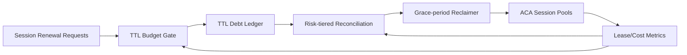

# ACA Session TTL Debt Reconciliation 选型 FAQ（Cycle 1900）

## 1) 3 分钟结论
- **核心问题：** 会话 TTL 在高峰期被频繁续租后，若缺少债务对账机制，会造成资源长期占用与回收延迟。
- **推荐方案：** “TTL 债务账本 + 分层续租预算 + 到期回收宽限梯度”协同治理。
- **目标：** 在保障关键会话连续性的同时，避免续租债务累积拖垮池容量。

## 2) Q1 / Q2 / Q3
### Q1：为什么 TTL 续租会形成债务问题？
1) 峰值保护策略会批量延长会话寿命；
2) 无对账机制时历史续租难以回补；
3) 回收窗口被挤压后会放大后续冷启动成本。

### Q2：生产级 TTL debt reconciliation 如何落地？
- **债务账本：** 记录每次续租的额度、原因、租户与窗口；
- **预算分层：** 关键/普通会话采用不同续租上限；
- **宽限梯度：** 到期回收按风险等级分批执行；
- **策略闭环：** 依据债务余额动态收紧续租阈值。

### Q3：上线判据是什么？
- 续租债务余额在可控区间内波动；
- 回收成功率与会话成功率同时达标；
- 冷启动成本未因回收策略恶化。

## 3) 架构图

## 4) 选型矩阵
| 维度 | 仅续租无对账 | TTL Debt Reconciliation（推荐） |
|---|---:|---:|
| 资源可回收性 | 低 | 高 |
| 会话连续性 | 中 | 高 |
| 成本稳定性 | 低 | 高 |
| 实施复杂度 | 低 | 中 |
| 治理可解释性 | 中 | 高 |

## 5) 证据与复算口径
- 证据文件：
  - `workshops/azure-agent-infra/evidence/cycle-1900-benchmark.json`
  - `workshops/azure-agent-infra/evidence/cycle-1900-latency.csv`
  - `workshops/azure-agent-infra/evidence/cycle-1900-throughput.csv`
  - `workshops/azure-agent-infra/evidence/cycle-1900-cost.csv`
- 标签：`measured / synthetic / anonymized_reported`。
- 校验链：FAQ 六段、CSP、cycle/topic 绑定、模拟器检查。

## 6) 生产检查清单
- [ ] TTL 续租事件完整写入债务账本。
- [ ] 关键与普通会话预算分层规则已压测。
- [ ] 到期宽限梯度具备回滚开关。
- [ ] 债务余额与回收成功率纳入告警体系。
- [ ] FAQ/H5/SVG/7-card/evidence 轮次一致。
