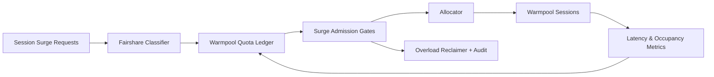

# ACA Session Warmpool Fairshare Surge Selection FAQ (Cycle 1911)

## 1) Three-minute decision
- **Core issue:** during multi-tenant session spikes, first-come warmpool allocation starves higher-priority tenants from fast recovery slots.
- **Recommendation:** apply fairshare warmpool quotas, surge admission gates, and overload-window reclamation.
- **Goal:** keep recovery latency stable under spikes while preventing single-tenant pool monopolization.

## 2) Q1 / Q2 / Q3
### Q1: Why add warmpool fairshare surge governance?
1) first-come allocation amplifies tenant contention,
2) surge traffic disrupts cold-start backfill rhythm,
3) missing reclaim windows creates zombie occupancy.

### Q2: How should production design work?
- **Share layer:** define baseline warmpool quotas by tenant and workload,
- **Gate layer:** apply priority+quota admission during surge windows,
- **Reclaim layer:** reclaim low-value/timeout sessions and refill critical tenants,
- **Observability layer:** audit recovery latency, denial rate, and reclaim hit ratio.

### Q3: What is the go-live bar?
- critical-tenant recovery p95 stays within target at peak,
- over-occupancy and contention rates trend down,
- gate and reclaim behavior is replayable and explainable.

## 3) Reference architecture

## 4) Decision matrix
| Dimension | First-come warmpool | Warmpool Fairshare Surge (Recommended) |
|---|---:|---:|
| Peak recovery stability | Low | High |
| Cross-tenant fairness | Low | High |
| Resource efficiency | Medium | High |
| Policy auditability | Medium | High |
| Implementation complexity | Low | Medium |

## 5) Evidence and reproducibility
- Evidence files:
  - `workshops/azure-agent-infra/evidence/cycle-1911-benchmark.json`
  - `workshops/azure-agent-infra/evidence/cycle-1911-latency.csv`
  - `workshops/azure-agent-infra/evidence/cycle-1911-throughput.csv`
  - `workshops/azure-agent-infra/evidence/cycle-1911-cost.csv`
- Labels: `measured / synthetic / anonymized_reported`.
- Repro method: fixed sampling window, fixed quota gates, fixed cost model.

## 6) Production checklist
- [ ] Tenant share policy aligns with SLA tiering.
- [ ] Surge admission parameters pass historical peak replay.
- [ ] Overload reclaim includes cooldown and rollback switches.
- [ ] Denial/reclaim trails are tenant-auditable.
- [ ] FAQ/H5/SVG/7-card/evidence remain cycle-topic consistent.
