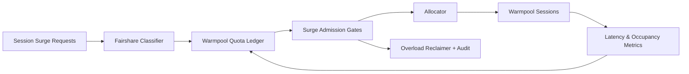

# ACA Session Warmpool Fairshare Surge 选型 FAQ（Cycle 1911）

## 1) 3 分钟结论
- **核心问题：** 多租户会话突增时，warm pool 若按先到先得分配，会导致高优先级租户拿不到恢复席位。
- **推荐方案：** “租户公平份额池 + 峰值突增闸门 + 过载窗口回收”三段治理。
- **目标：** 在突增压力下稳定会话恢复时延，并避免 warm pool 被单租户占满。

## 2) Q1 / Q2 / Q3
### Q1：为什么需要 warmpool fairshare surge？
1) 先到先得会放大租户资源争抢；
2) 峰值流量会拖垮冷启回补节奏；
3) 缺少回收窗口会造成池内“僵尸占位”。

### Q2：生产级如何设计？
- **份额层：** 为租户与工作负载定义基础 warm pool 配额；
- **闸门层：** 在突增窗口按优先级与配额执行 admission gate；
- **回收层：** 对超时/低价值会话执行过载窗口回收并回填关键租户；
- **观测层：** 对恢复时延、拒绝率、回收命中率做全链路审计。

### Q3：上线判据是什么？
- 峰值窗口关键租户恢复 P95 维持目标阈值；
- 超额占位率和抢占冲突率持续下降；
- 闸门与回收策略可回放、可解释、可复算。

## 3) 架构图

## 4) 选型矩阵
| 维度 | 先到先得 Warm Pool | Warmpool Fairshare Surge（推荐） |
|---|---:|---:|
| 峰值恢复稳定性 | 低 | 高 |
| 跨租户公平性 | 低 | 高 |
| 资源利用率 | 中 | 高 |
| 策略可审计性 | 中 | 高 |
| 实施复杂度 | 低 | 中 |

## 5) 证据与复算口径
- 证据文件：
  - `workshops/azure-agent-infra/evidence/cycle-1911-benchmark.json`
  - `workshops/azure-agent-infra/evidence/cycle-1911-latency.csv`
  - `workshops/azure-agent-infra/evidence/cycle-1911-throughput.csv`
  - `workshops/azure-agent-infra/evidence/cycle-1911-cost.csv`
- 标签：`measured / synthetic / anonymized_reported`。
- 口径：固定采样窗口、固定配额门禁、固定成本模型，支持重复复算。

## 6) 生产检查清单
- [ ] 租户份额与业务 SLA 等级一致。
- [ ] surge admission 参数通过历史峰值回放验证。
- [ ] overload reclaim 具备冷却与回滚开关。
- [ ] 拒绝与回收轨迹可按租户审计与查询。
- [ ] FAQ/H5/SVG/7-card/evidence 的 cycle/topic 一致。
