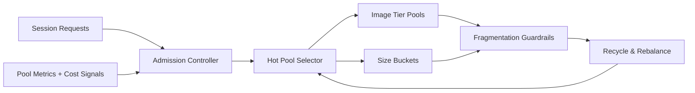

# ACA Session Pool Fragmentation Guardrails Selection FAQ (Cycle 1889)

## 1) Three-minute decision
- **Core issue:** ACA Dynamic Sessions can suffer pool fragmentation under mixed image and size demand, reducing effective capacity and increasing cold-start jitter.
- **Recommendation:** apply image-tiered pools, size bucketing, and fragmentation-recycle thresholds.
- **Goal:** improve pool utilization and recovery latency without weakening isolation boundaries.

## 2) Q1 / Q2 / Q3
### Q1: What are the typical symptoms of session-pool fragmentation?
1) idle instances remain in hard-to-reuse shapes,
2) peak rerouting triggers frequent cold starts,
3) per-session cost rises at equivalent concurrency.

### Q2: How should production guardrails be implemented?
- **Image-tier pools:** maintain dedicated warm pools by base image family,
- **Size bucketing:** discretize CPU/memory classes to limit micro-fragmentation,
- **Recycle thresholds:** reclaim and rebalance low-hit partitions,
- **Orchestration coupling:** inject pool-hit and recycle signals into admission.

### Q3: What is the go-live bar?
- sustained higher and more stable warm-pool hit rates,
- lower cold-start P95 against baseline,
- lower and steadier per-session cost at target throughput.

## 3) Reference architecture

## 4) Decision matrix
| Dimension | No fragmentation controls | Fragmentation Guardrails (Recommended) |
|---|---:|---:|
| Warm-pool hit rate | Low | High |
| Cold-start stability | Low | High |
| Cost controllability | Medium | High |
| Implementation complexity | Low | Medium |
| Observability & explainability | Medium | High |

## 5) Evidence and reproducibility
- Evidence files:
  - `workshops/azure-agent-infra/evidence/cycle-1889-benchmark.json`
  - `workshops/azure-agent-infra/evidence/cycle-1889-latency.csv`
  - `workshops/azure-agent-infra/evidence/cycle-1889-throughput.csv`
  - `workshops/azure-agent-infra/evidence/cycle-1889-policy.csv`
- Source tags: `measured / synthetic / anonymized_reported`.
- validation7 enforces six-part structure, CSP-safe 7-card output, strict cycle-topic integrity, and replayable checks.

## 6) Production checklist
- [ ] Image families and size buckets are observable and stable.
- [ ] Recycle thresholds are validated under load.
- [ ] Admission is integrated with recycle feedback.
- [ ] Cost dashboard tracks hit rate, cold starts, and per-session spend.
- [ ] FAQ/H5/SVG/7-card/evidence are cycle-consistent.
