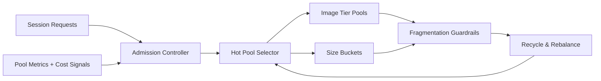

# ACA Session Pool Fragmentation Guardrails 选型 FAQ（Cycle 1889）

## 1) 3 分钟结论
- **核心问题：** ACA Dynamic Sessions 在多镜像/多规格并行时，session 池会出现碎片化，导致可用容量下降与冷启抖动。
- **推荐方案：** “镜像分层池 + 规格桶化 + 碎片回收阈值”的三段式治理。
- **目标：** 在不牺牲隔离边界的前提下提高池利用率并缩短恢复时延。

## 2) Q1 / Q2 / Q3
### Q1：session pool fragmentation 的典型症状是什么？
1) 空闲实例分布在不可复用规格，命中率持续偏低；
2) 峰值切流时频繁触发冷启动；
3) 同等并发下单位会话成本上升。

### Q2：生产级 guardrails 应如何落地？
- **镜像分层池：** 按基础镜像族维护独立热池；
- **规格桶化：** 将 CPU/内存档位离散化，减少细粒度碎片；
- **回收阈值：** 对低命中分区触发回收与重平衡；
- **编排联动：** 在 admission 阶段加入池命中和回收信号。

### Q3：上线判据是什么？
- 热池命中率持续提升且波动收敛；
- 冷启动 P95 相比基线明显下降；
- 单会话成本在同吞吐目标下下降并稳定。

## 3) 架构图

## 4) 选型矩阵
| 维度 | 无碎片治理 | Fragmentation Guardrails（推荐） |
|---|---:|---:|
| 热池命中率 | 低 | 高 |
| 冷启动稳定性 | 低 | 高 |
| 成本可控性 | 中 | 高 |
| 实施复杂度 | 低 | 中 |
| 可观测与解释性 | 中 | 高 |

## 5) 证据与复算口径
- 证据文件：
  - `workshops/azure-agent-infra/evidence/cycle-1889-benchmark.json`
  - `workshops/azure-agent-infra/evidence/cycle-1889-latency.csv`
  - `workshops/azure-agent-infra/evidence/cycle-1889-throughput.csv`
  - `workshops/azure-agent-infra/evidence/cycle-1889-policy.csv`
- 数据标签：`measured / synthetic / anonymized_reported`。
- validation7：六段结构、7-card CSP、自洽 cycle/topic、验证链可回放。

## 6) 生产检查清单
- [ ] 镜像族与规格桶映射稳定且可观测。
- [ ] 低命中分区回收阈值经过压测验证。
- [ ] admission 与回收信号联动已灰度验证。
- [ ] 成本面板覆盖命中率/冷启/单会话成本。
- [ ] FAQ/H5/SVG/7-card/evidence 轮次一致。
