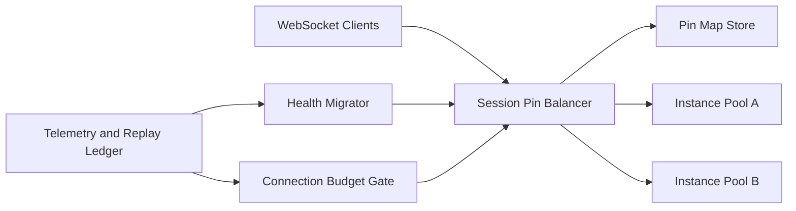

# ACA WebSocket Session Pin Selection FAQ (Cycle 1866)

## 1) Three-minute decision
- **Core issue:** without session pinning, long-lived CUA/browser connections lose context when traffic drifts across instances.
- **Recommendation:** session pinning + health-aware migration + connection budgeting.
- **Goal:** preserve session continuity under high concurrency while preventing instance hotspots.

## 2) Q1 / Q2 / Q3
### Q1: Why is standard load balancing insufficient?
1) long-lived connection state is session-coupled,
2) reconnect storms amplify cross-instance mismatch,
3) hotspot evacuation lacks deterministic control.

### Q2: What does production-grade session pinning require?
- **Pin policy:** bind session keys to instance partitions,
- **Health migration:** migrate by connection priority on degradation,
- **Connection budgets:** per-instance caps with backpressure,
- **Recovery semantics:** replay required context fragments after migration.

### Q3: How do we validate this design?
- reconnect success rate and recovery latency meet targets,
- hotspot connections are shaved by budget gates,
- migration does not introduce major policy false blocks.

## 3) Reference architecture

## 4) Decision matrix
| Dimension | Basic round-robin | Session pin + health migration (Recommended) |
|---|---:|---:|
| Session continuity | Low | High |
| Reconnect stability | Medium | High |
| Hotspot control | Low | High |
| Implementation complexity | Low | Medium |
| Observability | Medium | High |

## 5) Evidence and reproducibility
- Evidence files:
  - `workshops/azure-agent-infra/evidence/cycle-1866-benchmark.json`
  - `workshops/azure-agent-infra/evidence/cycle-1866-latency.csv`
  - `workshops/azure-agent-infra/evidence/cycle-1866-throughput.csv`
  - `workshops/azure-agent-infra/evidence/cycle-1866-policy.csv`
- Labels: `measured / synthetic / anonymized_reported`.
- validation7 enforces six-part structure, CSP-safe 7-card output, strict cycle-topic alignment, and replayable checks.

## 6) Production checklist
- [ ] Session pin mapping and TTL policy pass load testing.
- [ ] Health migration and context replay drills pass.
- [ ] Connection budget gates and backpressure integrate cleanly.
- [ ] Reconnect storm stability meets targets.
- [ ] FAQ/H5/SVG/7-card/evidence remain cycle-consistent.
