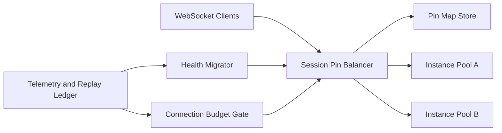

# ACA WebSocket Session Pin 选型 FAQ（Cycle 1866）

## 1) 3 分钟结论
- **核心问题：** CUA/Browser 类长连接场景若无 session pin，跨实例漂移会导致上下文断裂。
- **推荐方案：** “会话固定 + 健康迁移 + 连接预算”三段式架构。
- **目标：** 在高并发长连接场景中保障会话连续性，同时控制实例热点。

## 2) Q1 / Q2 / Q3
### Q1：为什么仅靠普通负载均衡不足？
1) 长连接状态高度会话化，随机转发会丢上下文；
2) reconnect 风暴会放大跨实例失配；
3) 热点实例缺少可控疏散策略。

### Q2：生产级 session pin 应如何设计？
- **Pin 策略：** 以会话键绑定实例分区；
- **健康迁移：** 实例降级时按连接优先级迁移；
- **连接预算：** 每实例并发连接上限 + 回压机制；
- **恢复语义：** 迁移后重放必要上下文片段。

### Q3：如何验证该方案？
- reconnect 成功率与恢复时延达标；
- 热点实例连接数可被预算闸门削峰；
- 迁移过程不引入显著策略误拦截。

## 3) 架构图

## 4) 选型矩阵
| 维度 | 普通轮询转发 | Session Pin + 健康迁移（推荐） |
|---|---:|---:|
| 会话连续性 | 低 | 高 |
| reconnect 稳定性 | 中 | 高 |
| 热点控制能力 | 低 | 高 |
| 实施复杂度 | 低 | 中 |
| 可观测性 | 中 | 高 |

## 5) 证据与复算口径
- 证据文件：
  - `workshops/azure-agent-infra/evidence/cycle-1866-benchmark.json`
  - `workshops/azure-agent-infra/evidence/cycle-1866-latency.csv`
  - `workshops/azure-agent-infra/evidence/cycle-1866-throughput.csv`
  - `workshops/azure-agent-infra/evidence/cycle-1866-policy.csv`
- 标签：`measured / synthetic / anonymized_reported`。
- validation7：六段结构、7-card CSP、自洽 cycle-topic、可回放验证链。

## 6) 生产检查清单
- [ ] session pin 映射与 TTL 策略完成压测。
- [ ] 健康迁移与上下文重放演练通过。
- [ ] 连接预算闸门与回压策略联调通过。
- [ ] reconnect 风暴场景下稳定性达标。
- [ ] FAQ/H5/SVG/7-card/evidence 轮次一致。
