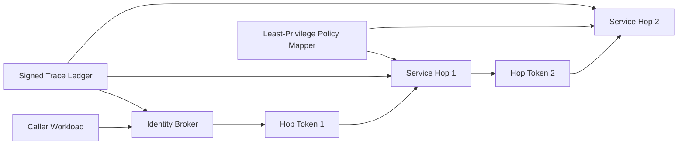

# ACA Workload Identity Hop Governance Selection FAQ (Cycle 1861)

## 1) Three-minute decision
- **Core tradeoff:** multi-hop identity delegation improves decoupling, but excessive hops increase privilege spread and trace breaks.
- **Recommendation:** minimal-hop topology, per-hop short-lived tokens, and downstream least-privilege mapping.
- **Goal:** keep identity traceable, privileges constrained, and failures diagnosable across component calls.

## 2) Q1 / Q2 / Q3
### Q1: Why is shared long-lived credential forwarding risky?
1) leaked credentials widen lateral-abuse blast radius,
2) missing call-context binding weakens audit accountability,
3) revocation propagation is slow and extends recovery windows.

### Q2: What production-grade workload-identity hop strategy should be used?
- **Minimal hops:** reduce delegation depth and prefer direct authorization,
- **Short-lived tokens:** per-hop TTL with audience and nonce binding,
- **Least-privilege mapping:** downstream fine-grained scopes by resource action,
- **Trace proof:** signed per-hop evidence for end-to-end replay.

### Q3: How do we validate governance effectiveness?
- lower privilege-violation alert rates,
- shorter token-revocation propagation time,
- faster incident localization with better replay completeness.

## 3) Reference architecture

## 4) Decision matrix
| Dimension | Shared long-lived credential | Minimal-hop short-token model (Recommended) |
|---|---:|---:|
| Privilege convergence | Low | High |
| Audit traceability | Low | High |
| Change recovery speed | Low | High |
| Implementation complexity | Low | Medium |
| Compliance readiness | Low | High |

## 5) Evidence and reproducibility
- Evidence files:
  - `workshops/azure-agent-infra/evidence/cycle-1861-benchmark.json`
  - `workshops/azure-agent-infra/evidence/cycle-1861-latency.csv`
  - `workshops/azure-agent-infra/evidence/cycle-1861-throughput.csv`
  - `workshops/azure-agent-infra/evidence/cycle-1861-policy.csv`
- Labels: `measured / synthetic / anonymized_reported`.
- validation7 enforces bilingual six-part structure, CSP self-contained 7-card output, strict cycle-evidence alignment, and replayability.

## 6) Production checklist
- [ ] Minimal-hop topology policy is frozen.
- [ ] Per-hop short tokens enforce audience/nonce binding.
- [ ] Downstream least-privilege mapping passes load tests.
- [ ] Signed hop evidence supports end-to-end replay.
- [ ] FAQ/H5/SVG/7-card align with cycle evidence.
