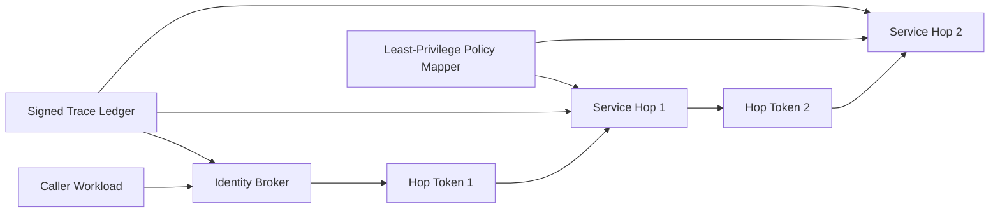

# ACA Workload Identity 跳点治理选型 FAQ（Cycle 1861）

## 1) 3 分钟结论
- **核心矛盾：** 多跳身份传递可提升系统解耦，但跳点越多越容易出现权限扩散与链路追溯断裂。
- **推荐：** 最少跳点设计 + 每跳短期令牌 + 下游最小权限映射。
- **目标：** 在跨组件调用中保持身份可追踪、权限可收敛、故障可定位。

## 2) Q1 / Q2 / Q3
### Q1：为什么“共享长期凭据跨服务传递”风险高？
1) 泄露后可横向滥用范围更大；
2) 缺少调用上下文绑定，审计难定位责任链；
3) 凭据更新与吊销传播慢，恢复窗口过长。

### Q2：生产级 Workload Identity 跳点策略如何设计？
- **最少跳点：** 限制身份传递层级，优先直达授权；
- **短期令牌：** 每跳签发短 TTL、绑定 audience 与 nonce；
- **最小权限映射：** 下游按资源动作映射细粒度 scope；
- **链路证明：** 每跳写入签名调用证据，支持端到端回放。

### Q3：如何验证跳点治理有效？
- 权限越界告警率下降；
- 令牌吊销生效时间缩短；
- 故障定位时间与回放完整性提升。

## 3) 架构图

## 4) 选型矩阵
| 维度 | 长期共享凭据 | 最小跳点短令牌（推荐） |
|---|---:|---:|
| 权限收敛 | 低 | 高 |
| 审计可追溯 | 低 | 高 |
| 变更恢复速度 | 低 | 高 |
| 实施复杂度 | 低 | 中 |
| 合规适配 | 低 | 高 |

## 5) 证据与复算口径
- 证据文件：
  - `workshops/azure-agent-infra/evidence/cycle-1861-benchmark.json`
  - `workshops/azure-agent-infra/evidence/cycle-1861-latency.csv`
  - `workshops/azure-agent-infra/evidence/cycle-1861-throughput.csv`
  - `workshops/azure-agent-infra/evidence/cycle-1861-policy.csv`
- 标签：`measured / synthetic / anonymized_reported`。
- validation7：双语六段结构、7-card CSP 自包含、轮次与 evidence 一致、可回放链路通过。

## 6) 生产检查清单
- [ ] 最少跳点拓扑规则已固化。
- [ ] 每跳短期令牌绑定 audience/nonce 生效。
- [ ] 下游最小权限映射策略通过压测。
- [ ] 签名链路证据支持端到端回放。
- [ ] FAQ/H5/SVG/7-card 与 evidence 轮次一致。
