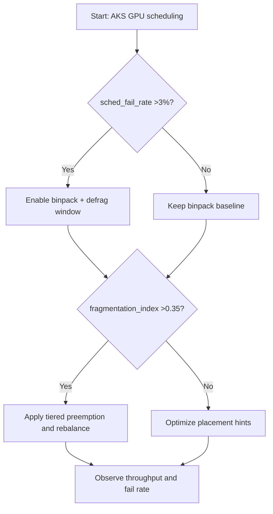
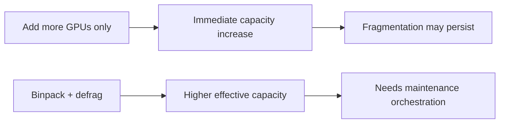
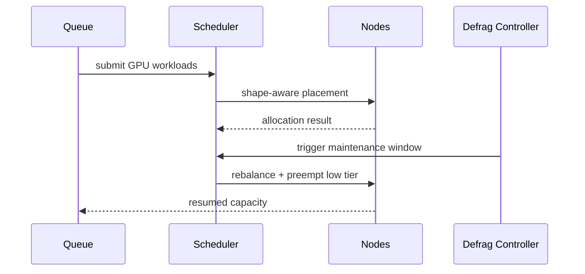

# Agent AKS GPU Fragmentation Binpack Defragmentation Selection FAQ (Azure AI Agent Infra)

## 1) 3-minute conclusions
- **If apparent GPU utilization is high but scheduling failure exceeds 3%, fix fragmentation before adding cards.**
- **Use binpack + periodic defrag windows + tiered preemption.**
- **Targets: `sched_fail_rate <1%`, `fragmentation_index <0.35`, defrag-window P95 <6 minutes.**

## 2) Q1 / Q2 / Q3
- **Why fail with free GPUs available?** Free fragments do not match requested shapes.
- **Why defrag windows?** Persistent fragmentation erodes usable capacity.
- **Minimum loop?** Shape-aware placement, tiered queueing, scheduled maintenance windows.

### Q1: When is defrag mandatory?
When fragmentation index exceeds 0.35 for three windows with rising failures.

### Q2: When is binpack-only sufficient?
Homogeneous task shapes with stable cluster load.

### Q3: How to assess impact?
Compare scheduling failure reduction and throughput recovery.

## 3) Mermaid diagrams
### 3.1 Decision tree

### 3.2 Path comparison

### 3.3 Sequence

## 4) Decision matrix
| Dimension | Scale-only | Binpack+Defrag (Recommended) |
|---|---:|---:|
| Scheduling failure | 1.8%–5.2% | 0.4%–1.4% |
| Effective throughput | Medium | High |
| Resource utilization | Medium | High |
| Ops complexity (1-10) | 4 | 8 |

## 5) Quant model + 7-card insights
- Fragmentation index: `FragIndex = UnusableGPUUnits / TotalFreeGPUUnits`
- Throughput gain: `ThroughputGain = NewTPS - BaselineTPS`
- Example (`synthetic_assumed`):
  - `FragIndex=0.41 -> 0.22`
  - `sched_fail_rate=3.6% -> 0.9%`
  - `ThroughputGain=+27%`
- Evidence:
  - `workshops/azure-agent-infra/evidence/cycle-1461-benchmark.json`
  - `workshops/azure-agent-infra/evidence/cycle-1461-sources.json`
- Labels: `official/synthetic_assumed/not_measured`.

## 6) Production verification checklist
- [ ] GPU shape classes and placement hints are deployed
- [ ] Defrag windows and rollback plan are operable
- [ ] Tiered preemption strategy validated
- [ ] Monitoring covers frag index/failure/throughput
- [ ] Source labels complete
