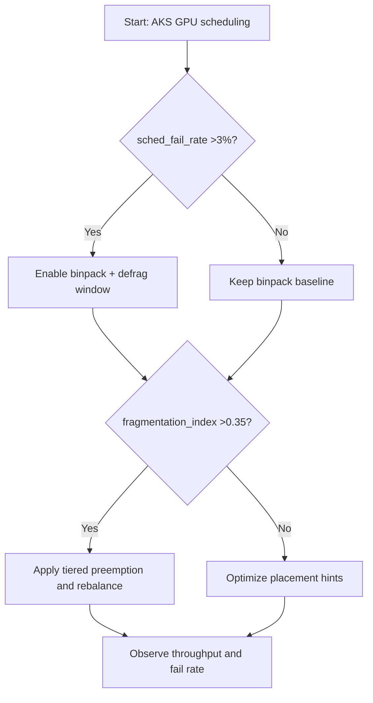
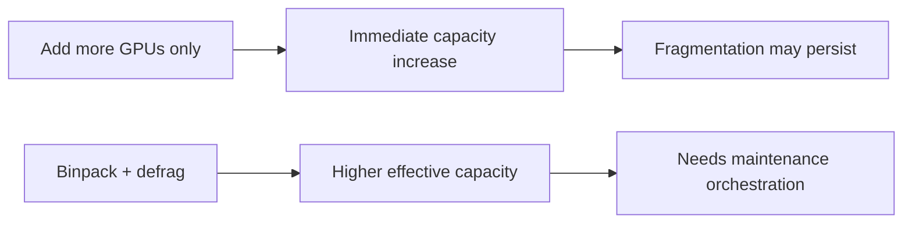
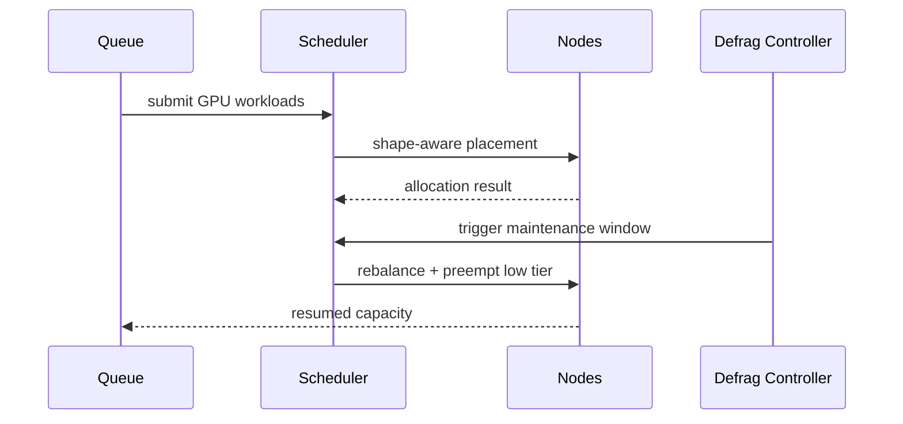

# Agent AKS GPU Fragmentation Binpack Defragmentation 选型 FAQ（Azure AI Agent Infra）

## 1) 3 分钟结论
- **当 GPU 利用率看似高但可调度失败率 >3% 时，优先处理碎片化而非盲目加卡。**
- **应采用“binpack + 周期性 defrag 窗口 + 任务分级抢占”组合策略。**
- **生产阈值：`sched_fail_rate <1%`、`fragmentation_index <0.35`、defrag 窗口 P95 <6 分钟。**

## 2) Q1 / Q2 / Q3
- **为什么有空闲 GPU 还调度失败？**：可用片段不满足请求形状。
- **为什么要 defrag 窗口？**：持续碎片会吞噬可用容量。
- **最小闭环？**：形状感知调度、分层队列、维护窗口。

### Q1：何时必须触发 defrag？
当碎片指数连续 3 个窗口 >0.35 且失败率上升。

### Q2：何时可以仅 binpack？
任务形状单一且负载平稳的短周期集群。

### Q3：如何评估效果？
比较调度失败下降与吞吐恢复增益。

## 3) Mermaid 图
### 3.1 决策树

### 3.2 路径对比

### 3.3 时序

## 4) 决策矩阵
| 维度 | 仅扩容 | Binpack+Defrag（推荐） |
|---|---:|---:|
| 调度失败率 | 1.8%–5.2% | 0.4%–1.4% |
| 有效吞吐 | 中 | 高 |
| 资源利用率 | 中 | 高 |
| 运维复杂度（1-10） | 4 | 8 |

## 5) 定量算例与 7-Card 洞察
- 碎片指数：`FragIndex = UnusableGPUUnits / TotalFreeGPUUnits`
- 吞吐恢复：`ThroughputGain = NewTPS - BaselineTPS`
- 示例（`synthetic_assumed`）：
  - `FragIndex=0.41 -> 0.22`
  - `sched_fail_rate=3.6% -> 0.9%`
  - `ThroughputGain=+27%`
- 证据：
  - `workshops/azure-agent-infra/evidence/cycle-1461-benchmark.json`
  - `workshops/azure-agent-infra/evidence/cycle-1461-sources.json`
- 标签：`official/synthetic_assumed/not_measured`。

## 6) 生产核验 Checklist
- [ ] GPU 任务形状分类与调度提示上线
- [ ] defrag 维护窗口与回退策略可执行
- [ ] 分级抢占策略已验证
- [ ] 监控覆盖碎片指数/失败率/吞吐
- [ ] 文档来源标签完整
