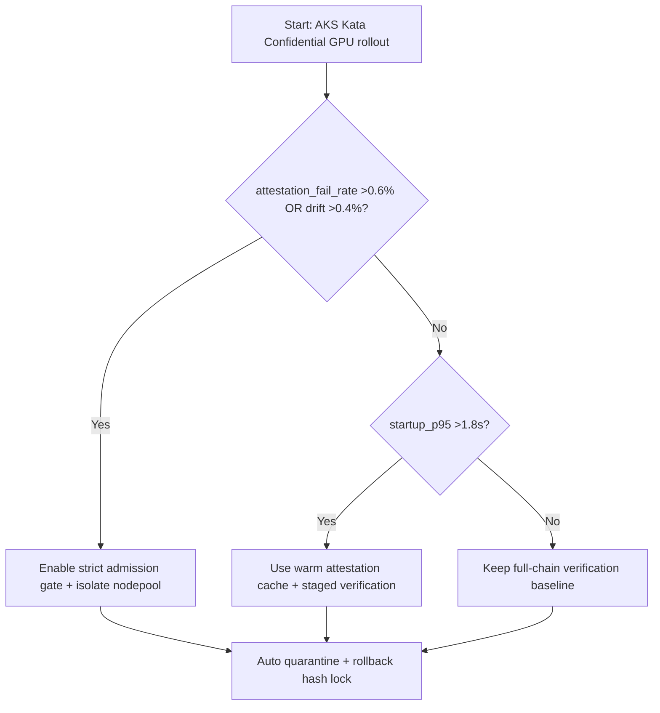
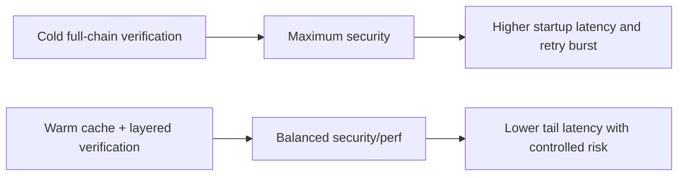
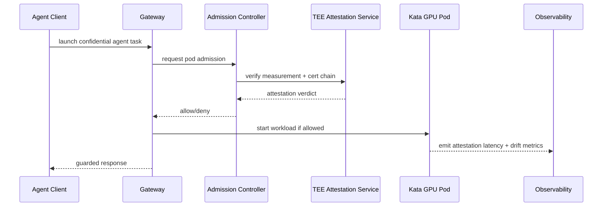

# Agent AKS Kata Confidential GPU Pod Attestation Chain Selection FAQ (Azure AI Agent Infra)

## 1) 3-minute conclusions
- **If end-to-end attestation-chain verification P95 exceeds 1.8s and failure rate exceeds 0.6%, prefer warm-attestation cache + layered verification**, not full cold verification per invocation.
- **If measurement drift exceeds 0.4% in mixed node pools, enforce RuntimeClass isolation + node-label constraints + admission gating** to prevent policy bypass.
- **Production baseline for AKS Kata Confidential GPU: measurement allow-list, TEE cert rotation window, and rollback hash lock**—missing any one of these is a no-go.

## 2) Q1 / Q2 / Q3 (plain language)
- **What is the attestation chain?** A verifiable identity chain from hardware TEE to workload runtime.
- **Why is it slow?** Cold signature validation + remote certificate fetch + scheduling churn.
- **Minimum safe loop?** Immutable measurement -> node admission -> runtime verification -> drift alert -> automatic quarantine.

### Q1: When must isolation be enforced?
When `attestation_fail_rate > 0.6%` or `measurement_drift > 0.4%`, block new traffic on the affected node pool.

### Q2: When can controls be relaxed?
Only in single-tenant load-test environments with no sensitive payloads.

### Q3: How to make this CTO/CFO computable?
Model added latency and retry-driven GPU minute cost, then compare against security gain and incident-risk reduction.

## 3) Mermaid (decision / path / sequence)
### 3.1 Decision tree

### 3.2 Path comparison

### 3.3 Runtime sequence

## 4) Architecture parameter matrix
| Dimension | Cold full-chain verification | Warm cache + layered verification (Recommended) |
|---|---:|---:|
| Startup P95 | 1.8–2.6s | 0.9–1.5s |
| Attestation failure threshold | 0.6% (hard gate) | 0.6% (hard gate) |
| Drift tolerance | 0.4% | 0.4% |
| Retry amplification | 1.9x–2.7x | 1.2x–1.6x |
| Ops complexity (1-10) | 6 | 8 |
| Production default | ⚠️ secure but less elastic | ✅ balanced |

## 5) Formula + 7-card insights
- Added startup latency: `ΔLatency = VerifyTime + CertFetchTime + RetryPenalty`
- Added session cost: `ΔCost = (RetryCount * GPU_Minute_Price * RetryMinutes) + AttestationOverhead`
- Example (`synthetic_assumed`):
  - `VerifyTime=780ms, CertFetch=340ms, RetryPenalty=260ms`
  - `ΔLatency=1380ms`
  - `RetryCount=1.4, GPU_Minute_Price=$0.046, RetryMinutes=0.12`
  - `ΔCost≈$0.0077/session`
- Evidence pointers:
  - `workshops/azure-agent-infra/evidence/cycle-1447-benchmark.json`
  - `workshops/azure-agent-infra/evidence/cycle-1447-sources.json`
- Label boundaries: metrics are `synthetic_assumed`; mechanism docs are `official`; no production-measured claim unless explicitly labeled.

## 6) Production verification checklist
- [ ] RuntimeClass/NodeSelector/Taints are hard-bound to confidential GPU pools
- [ ] Cert rotation window is linked with rollback hash-lock policy
- [ ] Admission Gate auto-quarantines nodes above failure/drift thresholds
- [ ] Observability includes verify latency, drift rate, retry amplification, rollback success
- [ ] Source labels are complete (`official/synthetic_assumed/not_measured`)
