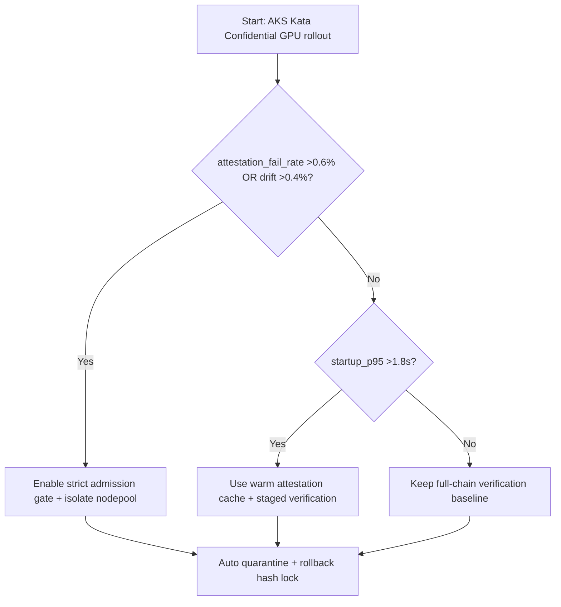
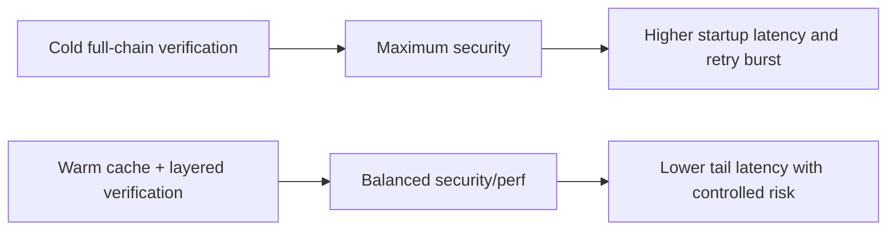
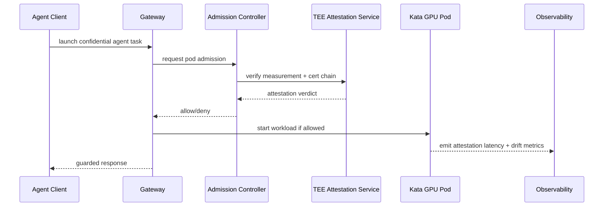

# Agent AKS Kata Confidential GPU Pod Attestation Chain 选型 FAQ（Azure AI Agent Infra）

## 1) 3 分钟结论（先给负责人）
- **当机密 GPU 证明链（attestation chain）端到端验证 P95 >1.8s，且失败率 >0.6% 时，优先选择“预热证明缓存 + 分层验签”方案**，不要每次都全链路冷验。
- **当节点池混部导致测量值（measurement）漂移 >0.4% 时，必须启用“RuntimeClass 隔离 + 节点标签强约束 + Admission Gate”**，否则策略绕过风险显著上升。
- **AKS Kata + Confidential GPU 的生产基线：测量白名单、TEE 证书轮换窗口、回滚哈希锁**；缺一项都不建议大规模上线。

## 2) Q1 / Q2 / Q3（大白话）
- **什么是证明链？**：从硬件 TEE 到容器工作负载的一串“身份证明”，每一段都要可验签、可追溯。
- **为什么会慢？**：全链路冷验签 + 远程证书拉取 + 频繁节点调度，会把启动尾延迟拉高。
- **最小安全闭环？**：镜像测量固化 -> 节点准入 -> 运行时验签 -> 漂移告警 -> 自动隔离。

### Q1：何时必须触发隔离门禁？
`attestation_fail_rate > 0.6%` 或 `measurement_drift > 0.4%` 时，立即禁止新流量进入该节点池。

### Q2：何时可以放宽？
仅在单租户压测环境且无敏感数据时，允许短时关闭二级验签。

### Q3：怎么做可复算的 TCO 评估？
用“证明耗时、失败重试、GPU 分钟成本”计算单会话附加成本，再对比安全收益。

## 3) Mermaid（决策树 / 路径 / 时序）
### 3.1 选型决策树

### 3.2 路径对比

### 3.3 运行时序

## 4) 架构参数对比矩阵
| 维度 | 全链路冷验签 | 预热缓存+分层验签（推荐） |
|---|---:|---:|
| 启动 P95 | 1.8–2.6s | 0.9–1.5s |
| 证明失败阈值 | 0.6%（硬门） | 0.6%（硬门） |
| 漂移容忍 | 0.4% | 0.4% |
| 重试放大倍数 | 1.9x–2.7x | 1.2x–1.6x |
| 运维复杂度（1-10） | 6 | 8 |
| 生产默认建议 | ⚠️高安全低弹性 | ✅安全与性能平衡 |

## 5) 公式与 7-Card 洞察
- 启动附加时延：`ΔLatency = VerifyTime + CertFetchTime + RetryPenalty`
- 单会话附加成本：`ΔCost = (RetryCount * GPU_Minute_Price * RetryMinutes) + AttestationOverhead`
- 示例（`synthetic_assumed`）：
  - `VerifyTime=780ms, CertFetch=340ms, RetryPenalty=260ms`
  - `ΔLatency=1380ms`
  - `RetryCount=1.4, GPU_Minute_Price=$0.046, RetryMinutes=0.12`
  - `ΔCost≈$0.0077/session`
- 证据文件：
  - `workshops/azure-agent-infra/evidence/cycle-1447-benchmark.json`
  - `workshops/azure-agent-infra/evidence/cycle-1447-sources.json`
- 标签边界：指标为 `synthetic_assumed`；官方机制说明保留 `official`；未声称生产实测。

## 6) 生产核验 Checklist
- [ ] RuntimeClass / NodeSelector / Taints 与机密 GPU 池严格绑定
- [ ] 证明链证书轮换窗口与回滚哈希锁已联动
- [ ] Admission Gate 在失败阈值触发时自动隔离节点
- [ ] 观测项包含：验签延迟、漂移率、重试放大、回滚成功率
- [ ] FAQ 与 7-Card 来源标注完整（`official/synthetic_assumed/not_measured`）
