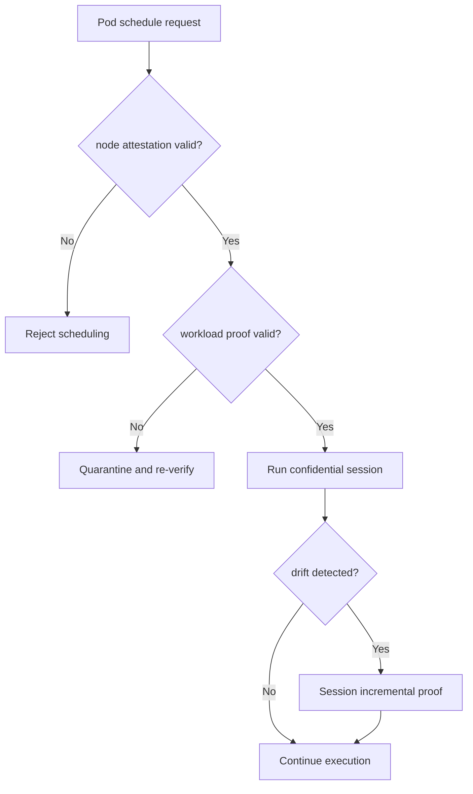
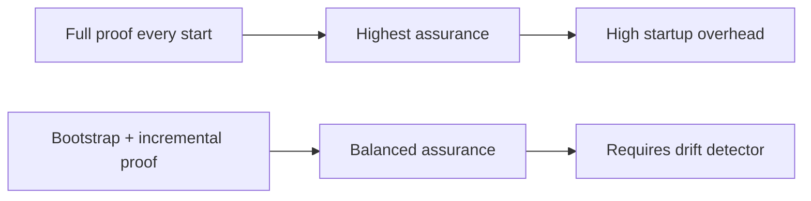
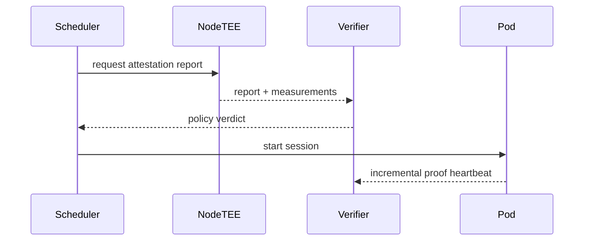

# Agent AKS Kata Confidential GPU Proof Chain Selection FAQ (Azure AI Agent Infra)

## 1) 3-minute conclusions
- **In confidential GPU + Kata paths, proof-chain design sets both audit quality and cold-start overhead ceilings.**
- **Recommended: bootstrap proof minimum set + in-session incremental proof.**
- **Targets: `proof_verify_p95 <2.4s`, `cold_start_p95 <18s`, `attestation_gap=0`.**

## 2) Q1 / Q2 / Q3
- **Why can proof chains be slow?** TEE report, image signature, and driver measurements are verified in sequence.
- **Why staged verification?** Keep heavyweight checks at strict boundaries; avoid repeated per-start penalties.
- **Minimum loop?** Node proof, workload proof, session drift alerting.

### Q1: When to reject scheduling?
When node attestation is incomplete or policy versions mismatch.

### Q2: When to allow downgrade?
Only for non-confidential jobs with explicit human approval.

### Q3: How to measure value?
Compare audit verifiability gain against tail latency cost.

## 3) Mermaid diagrams
### 3.1 Decision tree

### 3.2 Path comparison

### 3.3 Sequence

## 4) Decision matrix
| Dimension | Full proof every start | Bootstrap + incremental proof (Recommended) |
|---|---:|---:|
| Audit provability | High | High |
| Cold-start latency | Lower score | Higher score |
| Ops complexity (1-10) | 6 | 8 |
| Drift detection | Medium | High |
| Cost efficiency | Medium | High |

## 5) Quant model + 7-card insights
- Proof gain: `ProofGain = FullProofP95 - IncrementalProofP95`
- Gap rate: `GapRate = MissingAttestation / TotalSessions`
- Example (`synthetic_assumed`):
  - `FullProofP95=4.1s, IncrementalProofP95=1.8s`
  - `ProofGain=2.3s`
  - `MissingAttestation=0, TotalSessions=9,200`
  - `GapRate=0`
- Evidence:
  - `workshops/azure-agent-infra/evidence/cycle-1472-benchmark.json`
  - `workshops/azure-agent-infra/evidence/cycle-1472-sources.json`
- Labels: `official/synthetic_assumed/not_measured`.

## 6) Production verification checklist
- [ ] Node TEE reports are bound to policy versions
- [ ] Workload proof-chain and signatures are auditable
- [ ] Incremental drift alerts are wired in
- [ ] Non-confidential downgrade path has approval gates
- [ ] FAQ/7-card source labels are complete
