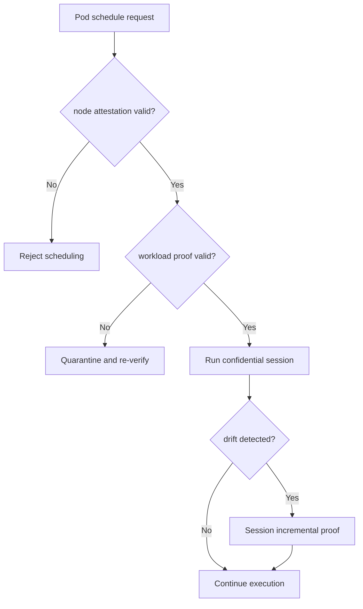
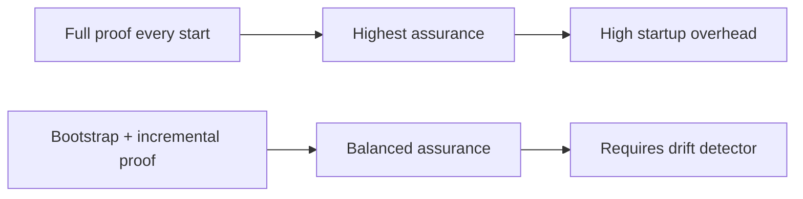
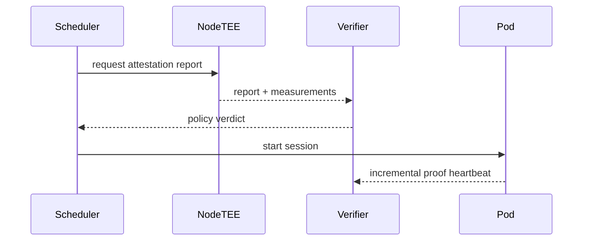

# Agent AKS Kata Confidential GPU Proof Chain 选型 FAQ（Azure AI Agent Infra）

## 1) 3 分钟结论
- **Confidential GPU + Kata 的证明链路决定了可审计级别与冷启动开销上限。**
- **推荐“启动证明最小集 + 会话内增量证明”两段式策略。**
- **目标阈值：`proof_verify_p95 <2.4s`、`cold_start_p95 <18s`、`attestation_gap=0`。**

## 2) Q1 / Q2 / Q3
- **为什么证明链会慢？**：TEE 报告、镜像签名、驱动测量都需串联验证。
- **为什么分段验证？**：把重校验留在关键边界，减少每次启动重复成本。
- **最小闭环？**：节点证明、工作负载证明、会话漂移告警。

### Q1：何时拒绝调度？
当节点证明不完整或策略版本不匹配。

### Q2：何时允许降级？
仅在非机密任务、且人工批准策略下。

### Q3：如何衡量价值？
比较审计可验证性与尾延迟成本。

## 3) Mermaid 图
### 3.1 决策树

### 3.2 路径对比

### 3.3 时序

## 4) 决策矩阵
| 维度 | 每次全量证明 | 启动+增量证明（推荐） |
|---|---:|---:|
| 审计可证明性 | 高 | 高 |
| 冷启动时延 | 低分 | 高分 |
| 运维复杂度（1-10） | 6 | 8 |
| 漂移检测能力 | 中 | 高 |
| 成本效率 | 中 | 高 |

## 5) 定量算例与 7-Card 洞察
- 证明收益：`ProofGain = FullProofP95 - IncrementalProofP95`
- 缺口率：`GapRate = MissingAttestation / TotalSessions`
- 示例（`synthetic_assumed`）：
  - `FullProofP95=4.1s, IncrementalProofP95=1.8s`
  - `ProofGain=2.3s`
  - `MissingAttestation=0, TotalSessions=9,200`
  - `GapRate=0`
- 证据：
  - `workshops/azure-agent-infra/evidence/cycle-1472-benchmark.json`
  - `workshops/azure-agent-infra/evidence/cycle-1472-sources.json`
- 标签：`official/synthetic_assumed/not_measured`。

## 6) 生产核验 Checklist
- [ ] Node TEE 报告与策略版本绑定
- [ ] workload 证明链路与签名校验可审计
- [ ] 增量证明漂移告警已接入
- [ ] 非机密任务降级流程有审批
- [ ] FAQ/7-Card 来源标签完整
