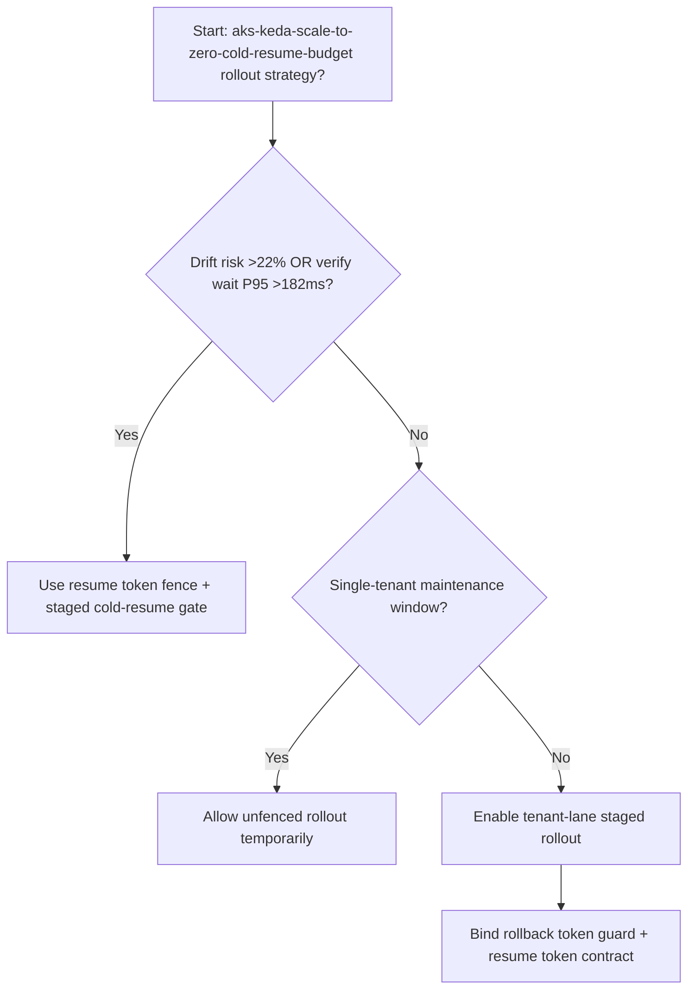
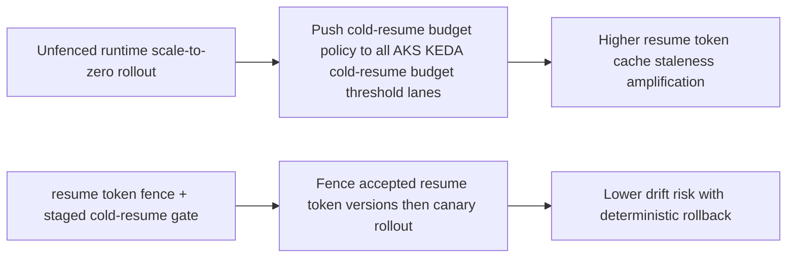
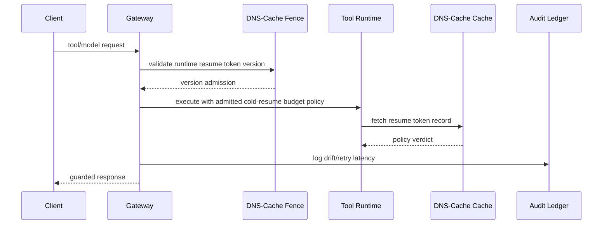

# Agent AKS KEDA Scale-to-Zero Cold Resume Budget Selection FAQ (Unfenced Scale-to-Zero Rollout vs Cold-Resume Fence + Staged Cold-Resume Gate)

## 1) Core conclusions (for decision-makers first)
- **When AKS KEDA scale-to-zero cold-resume jitter risk exceeds 22% and verification wait P95 exceeds 182ms, production should default to Cold-Resume Fence + Staged Cold-Resume Gate**.
- **When unfenced cold-resume overrun exceeds 12% and rollback retry P95 exceeds 252ms, Unfenced Scale-to-Zero Rollout enters the 12.1% overrun amplification band**.
- **Multi-tenant runtimes must bind resume token coherency fences, rollout batches, and rollback thresholds**, or policy execution and throughput stability degrade together.

## 2) Q1 / Q2 / Q3 (plain-language definitions first)
- **Unfenced Scale-to-Zero Rollout**: push new cold-resume budget policy to all AKS KEDA cold-resume budget threshold nodes directly; fast but risky.
- **Cold-Resume Fence + Staged Cold-Resume Gate**: constrain accepted resume token versions first, then shift traffic in batches.

### Q1: Why does runtime resume token coherency affect agent stability?
First principles: AKS KEDA cold-resume budget threshold lanes enforce policy and traffic governance. Cache-version drift causes execution divergence across nodes, amplifying retries and tail latency.

### Q2: When is unfenced rollout acceptable temporarily?
Only in single-tenant low-traffic maintenance windows. Multi-tenant production should default to cold-resume-fenced rollout.

### Q3: What is the minimum safe loop?
Version sampling -> fence validation -> staged rollout -> drift alerts -> automated rollback.

## 3) Mermaid (decision tree / path comparison / sequence)
### 3.1 Selection decision tree

### 3.2 Path comparison

### 3.3 Runtime sequence

## 4) Decision matrix
| Dimension | Unfenced Scale-to-Zero Rollout | Cold-Resume Fence + Staged Cold-Resume Gate |
|---|---|---|
| Implementation complexity | Low | Medium |
| resume token cache staleness risk | High | Low |
| Multi-tenant controllability | Low | High |
| Rollback determinism | Medium | High |
| Default production fit | Maintenance windows only | Long-term default |

## 5) Evidence contract + recomputable examples (n/denominator/source)
> Percentages in this section are `synthetic_assumed` hypothetical examples for mechanism comparison; production mechanism validation remains `not_measured`.  
> Contract fields: `workshops/azure-agent-infra/evidence/cycle-563-benchmark.json` -> `percentage_contract`.

- Metric A (unfenced resume token cache staleness rate)  
  - Formula: `n_unfenced_cold_resume_overrun / n_gateway_requests_observed`  
  - Value: `534/4410 = 12.1%` (`synthetic_assumed`)  
  - Path: `percentage_contract.unfenced_cold_resume_overrun_rate`
- Metric B (resume token fence overrun rate)  
  - Formula: `n_cold_resume_fence_overrun / n_gateway_requests_observed`  
  - Value: `216/4410 = 4.9%` (`synthetic_assumed`)  
  - Path: `percentage_contract.cold_resume_fence_overrun_rate`
- Metric C (recovery gain, percentage points)  
  - Formula: `n_cold_resume_fence_recovery_gain / n_gateway_requests_observed`  
  - Value: `330/4410 = 7.5 percentage points` (`synthetic_assumed`)  
  - Path: `percentage_contract.cold_resume_fence_recovery_gain_pts`

## 6) Production checklist
- [ ] Every tenant has AKS KEDA cold-resume budget threshold token-version allow-lists and rollout batches
- [ ] Drift rate, retry latency, and rollback success are observable and auditable
- [ ] Change flow supports canary rollout, fast rollback, and tiered promotion
- [ ] All metrics are tagged `synthetic_assumed`; production validation remains `not_measured`
