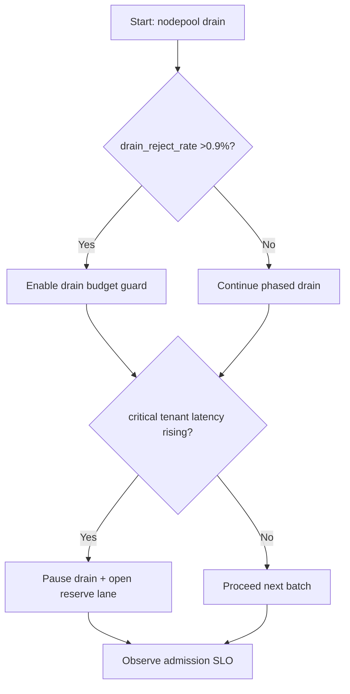
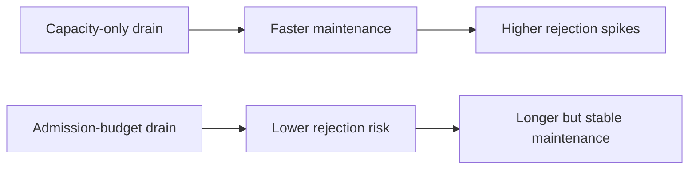
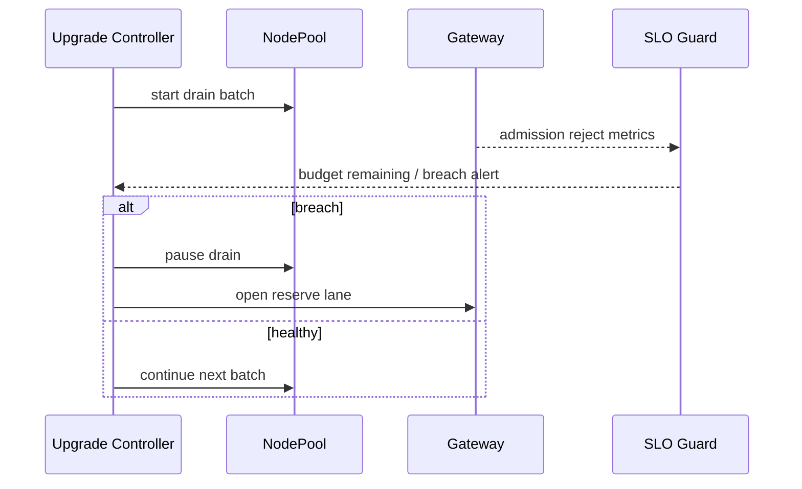

# Agent AKS NodePool Drain Admission Budget Guard Selection FAQ (Azure AI Agent Infra)

## 1) 3-minute conclusions
- **If nodepool drain causes admission reject >0.9%, enforce drain-budget guardrails plus tenant reserve lanes.**
- **Node count alone underestimates migration impact; request-admission budget should be the primary control metric.**
- **Targets: `drain_reject_rate <0.3%`, `rebalance_p95 <4min`, critical-tenant availability >=99.95%.**

## 2) Q1 / Q2 / Q3
- **Why do upgrades trigger reject spikes?** Drain and scale timings drift, causing temporary admission drops.
- **Why budget-based control?** It makes admissible capacity explicit and measurable.
- **Minimum loop?** Drain caps, phased migration, tenant reserve lanes, rollback thresholds.

### Q1: When must drain pause?
When admission failures breach threshold for two windows and critical-tenant latency worsens.

### Q2: When can drain accelerate?
Off-peak windows with healthy admission budget and no critical alerts.

### Q3: How to evaluate benefit?
Compare rejection-rate reduction versus maintenance-duration impact.

## 3) Mermaid diagrams
### 3.1 Decision tree

### 3.2 Path comparison

### 3.3 Sequence

## 4) Decision matrix
| Dimension | Capacity-first drain | Admission-budget drain (Recommended) |
|---|---:|---:|
| Upgrade-time reject rate | 0.6%–2.4% | 0.1%–0.5% |
| Total maintenance duration | Short | Medium |
| Critical-tenant stability | Medium | High |
| Ops complexity (1-10) | 4 | 7 |
| Auditability | Medium | High |

## 5) Quant model + 7-card insights
- Reject risk: `RejectRisk = RejectedReq / TotalReq`
- Upgrade gain: `UpgradeGain = BaselineReject - NewReject`
- Example (`synthetic_assumed`):
  - `RejectedReq=310, TotalReq=210,000`
  - `RejectRisk=0.148%`
  - `BaselineReject=1.1%, NewReject=0.35%`
  - `UpgradeGain=0.75pp`
- Evidence:
  - `workshops/azure-agent-infra/evidence/cycle-1466-benchmark.json`
  - `workshops/azure-agent-infra/evidence/cycle-1466-sources.json`
- Labels: `official/synthetic_assumed/not_measured`.

## 6) Production verification checklist
- [ ] Drain-budget and batch-threshold policies are active
- [ ] Reserve lane auto-open path is validated
- [ ] Pause/resume upgrade path is drill-tested
- [ ] Reject/latency/availability alerts are linked
- [ ] FAQ/7-card source labels are complete
