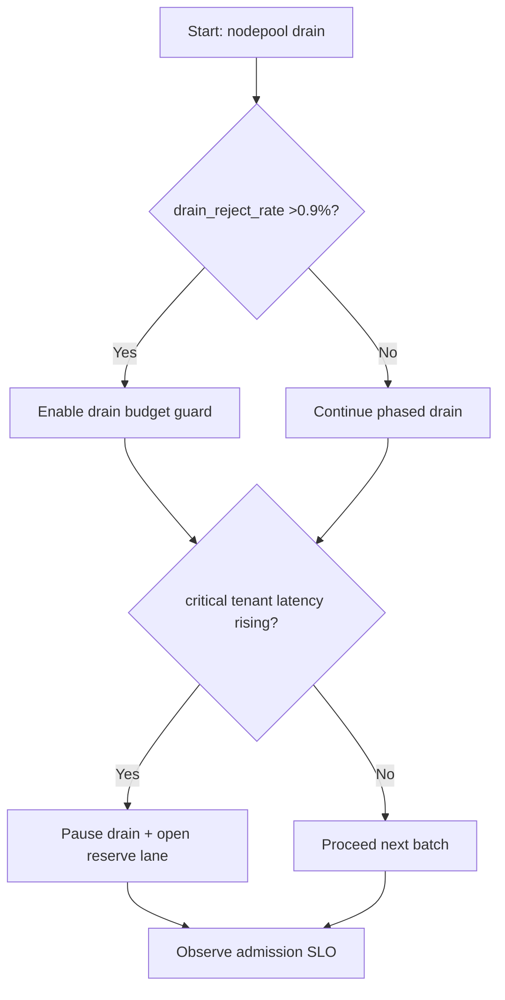
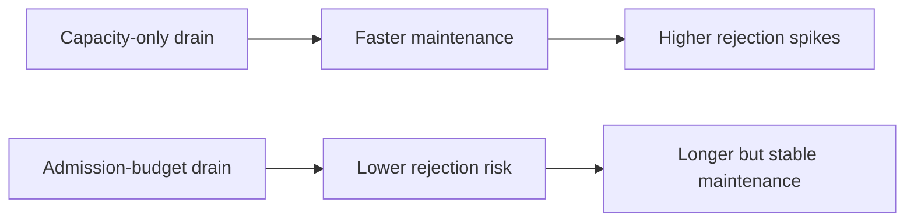
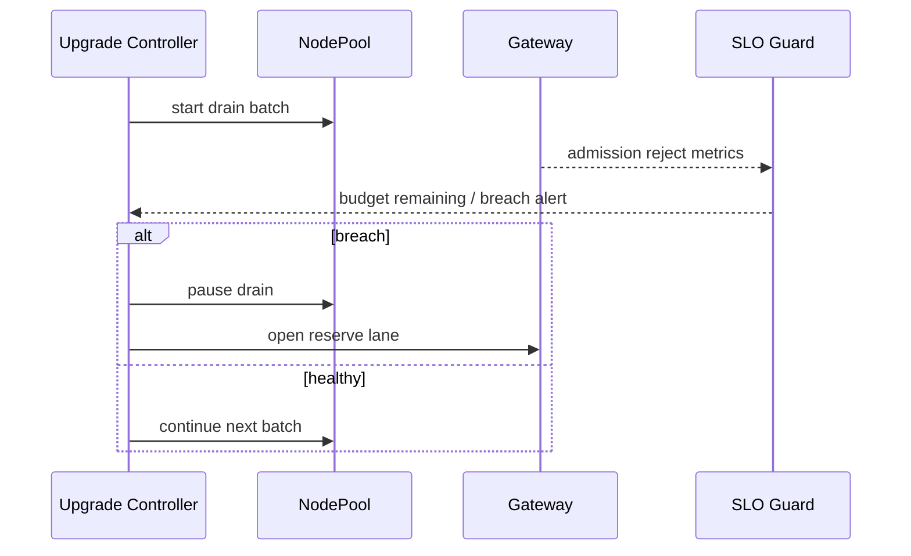

# Agent AKS NodePool Drain Admission Budget Guard 选型 FAQ（Azure AI Agent Infra）

## 1) 3 分钟结论
- **当节点池 drain 导致 admission reject >0.9% 时，必须启用“排空预算（drain budget）+ 租户保底通道”。**
- **只看节点可用数会低估切换冲击，应以可接纳请求预算作为主指标。**
- **生产阈值：`drain_reject_rate <0.3%`、`rebalance_p95 <4min`、关键租户可用性 >=99.95%。**

## 2) Q1 / Q2 / Q3
- **为什么升级窗口会触发突发拒绝？**：排空与扩容时序错位，瞬时接纳能力下降。
- **为什么要预算化？**：把“可接纳请求容量”显式化，避免盲排空。
- **最小闭环？**：排空上限、分批迁移、关键租户保底、回滚阈值。

### Q1：何时必须暂停排空？
当 admission 失败连续两个窗口超阈值且关键租户延迟恶化。

### Q2：何时可加速排空？
低峰期且预算余量充足、无关键告警。

### Q3：如何评估收益？
比较升级时段拒绝率下降与维护时长变化。

## 3) Mermaid 图
### 3.1 决策树

### 3.2 路径对比

### 3.3 时序

## 4) 决策矩阵
| 维度 | 容量导向排空 | admission 预算排空（推荐） |
|---|---:|---:|
| 升级期拒绝率 | 0.6%–2.4% | 0.1%–0.5% |
| 升级总时长 | 短 | 中 |
| 关键租户稳定性 | 中 | 高 |
| 运维复杂度（1-10） | 4 | 7 |
| 可审计性 | 中 | 高 |

## 5) 定量算例与 7-Card 洞察
- 拒绝风险：`RejectRisk = RejectedReq / TotalReq`
- 维护收益：`UpgradeGain = BaselineReject - NewReject`
- 示例（`synthetic_assumed`）：
  - `RejectedReq=310, TotalReq=210,000`
  - `RejectRisk=0.148%`
  - `BaselineReject=1.1%, NewReject=0.35%`
  - `UpgradeGain=0.75pp`
- 证据：
  - `workshops/azure-agent-infra/evidence/cycle-1466-benchmark.json`
  - `workshops/azure-agent-infra/evidence/cycle-1466-sources.json`
- 标签：`official/synthetic_assumed/not_measured`。

## 6) 生产核验 Checklist
- [ ] drain budget 与批次阈值策略生效
- [ ] 保底通道可在告警触发时自动开启
- [ ] 升级暂停/恢复路径演练通过
- [ ] reject/latency/可用性三指标联动告警
- [ ] FAQ/7-Card 来源标签完整
