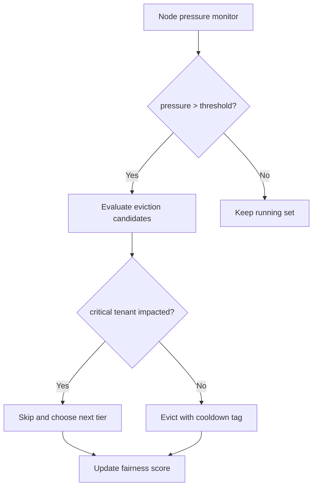
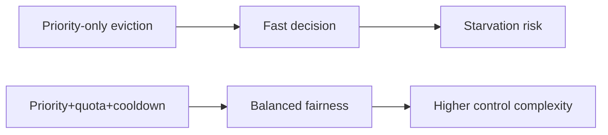
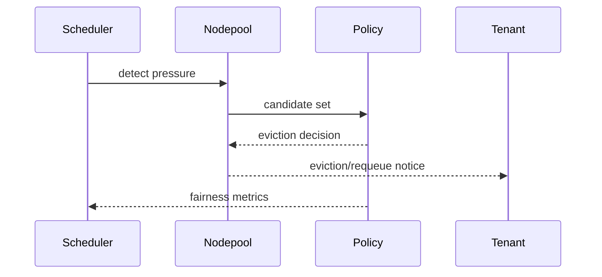

# Agent AKS Sandbox Nodepool Fair Eviction Selection FAQ (Azure AI Agent Infra)

## 1) 3-minute conclusions
- **Without fair eviction, AKS sandbox nodepools can starve critical tenants under pressure.**
- **Use priority + quota + cooldown eviction controls.**
- **Targets: `critical_tenant_eviction=0`, `eviction_recovery_p95 <6m`, `fairness_index >0.92`.**

## 2) Q1 / Q2 / Q3
- **Why unfairness occurs?** Short-burst jobs consume evictable capacity repeatedly.
- **Why not priority-only?** It can cause long-tail starvation for lower tiers.
- **Minimum loop?** Priority bands, tenant quotas, recovery cooldowns.

### Q1: When to evict?
When node pressure crosses threshold and queue congestion appears.

### Q2: When to pause evictions?
When critical tenants stabilize during recovery window.

### Q3: How to validate gain?
Compare recovery time, critical availability, and fairness index.

## 3) Mermaid diagrams
### 3.1 Decision tree

### 3.2 Path comparison

### 3.3 Sequence

## 4) Decision matrix
| Dimension | Priority-only | Priority+quota+cooldown (Recommended) |
|---|---:|---:|
| Fairness | Medium | High |
| Recovery speed | Medium | High |
| Ops complexity (1-10) | 4 | 8 |
| Critical tenant protection | Medium | High |
| Stability | Medium | High |

## 5) Quant model + 7-card insights
- Fairness index: `Fairness = 1 - Gini(resource_share)`
- Gain: `RecoveryGain = BaselineRecovery - GuardedRecovery`
- Example (`synthetic_assumed`):
  - `BaselineRecovery=11.2m, GuardedRecovery=5.4m`
  - `RecoveryGain=5.8m`
  - `Fairness=0.94`
- Evidence:
  - `workshops/azure-agent-infra/evidence/cycle-1483-benchmark.json`
  - `workshops/azure-agent-infra/evidence/cycle-1483-sources.json`
- Labels: `official/synthetic_assumed/not_measured`.

## 6) Production verification checklist
- [ ] Eviction policy includes priority/quota/cooldown controls
- [ ] Critical-tenant protection rules are auditable
- [ ] Recovery and requeue strategy is load-tested
- [ ] fairness_index dashboards are live
- [ ] FAQ/7-card source labels are complete
