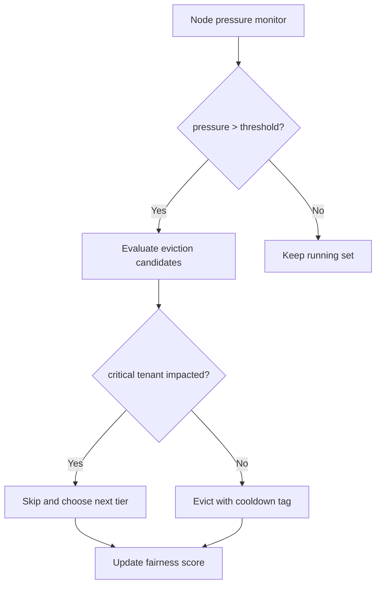
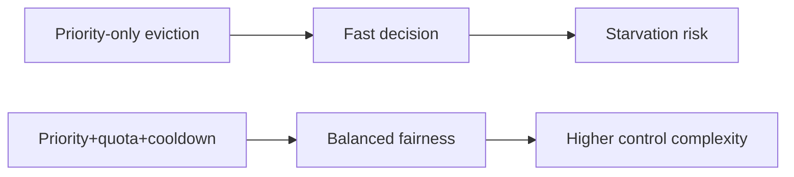
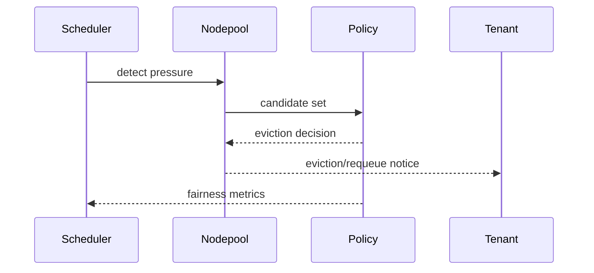

# Agent AKS Sandbox Nodepool Fair Eviction 选型 FAQ（Azure AI Agent Infra）

## 1) 3 分钟结论
- **AKS 沙盒节点池在资源压力下若无公平驱逐，会导致关键租户被饥饿。**
- **推荐“优先级+配额+冷却窗口”公平驱逐策略。**
- **目标阈值：`critical_tenant_eviction=0`、`eviction_recovery_p95 <6m`、`fairness_index >0.92`。**

## 2) Q1 / Q2 / Q3
- **为何会不公平？**：短作业高频突发占满可驱逐空间。
- **为何不能只按优先级？**：会放大低优先级长期饥饿。
- **最小闭环？**：优先级分层、租户配额、恢复冷却。

### Q1：何时触发驱逐？
节点压力超阈值并出现队列拥塞。

### Q2：何时暂停驱逐？
恢复窗口内关键租户稳定。

### Q3：如何验证收益？
比较恢复时间、关键租户可用性与公平指数。

## 3) Mermaid 图
### 3.1 决策树

### 3.2 路径对比

### 3.3 时序

## 4) 决策矩阵
| 维度 | 仅优先级 | 优先级+配额+冷却（推荐） |
|---|---:|---:|
| 公平性 | 中 | 高 |
| 恢复速度 | 中 | 高 |
| 运维复杂度（1-10） | 4 | 8 |
| 关键租户保护 | 中 | 高 |
| 稳定性 | 中 | 高 |

## 5) 定量算例与 7-Card 洞察
- 公平指数：`Fairness = 1 - Gini(resource_share)`
- 收益：`RecoveryGain = BaselineRecovery - GuardedRecovery`
- 示例（`synthetic_assumed`）：
  - `BaselineRecovery=11.2m, GuardedRecovery=5.4m`
  - `RecoveryGain=5.8m`
  - `Fairness=0.94`
- 证据：
  - `workshops/azure-agent-infra/evidence/cycle-1483-benchmark.json`
  - `workshops/azure-agent-infra/evidence/cycle-1483-sources.json`
- 标签：`official/synthetic_assumed/not_measured`。

## 6) 生产核验 Checklist
- [ ] 驱逐策略含优先级/配额/冷却三维度
- [ ] 关键租户保护规则可审计
- [ ] 恢复窗口与重排策略压测通过
- [ ] fairness_index 仪表板持续更新
- [ ] FAQ/7-Card 来源标签完整
