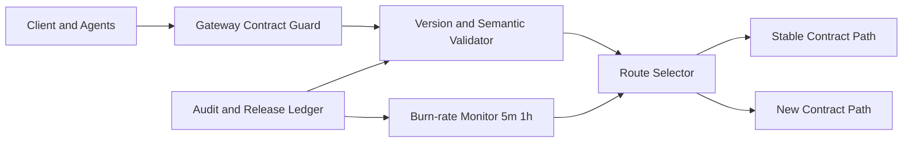

# Agent API Schema Drift Burn-rate Selection FAQ (Cycle 1864)

## 1) Three-minute decision
- **Core issue:** under multi-model and multi-tool orchestration, API schema drift can trigger burst failures during peak traffic.
- **Recommendation:** combine contract layering, burn-rate alerting, and automatic fallback routing.
- **Goal:** convert schema drift from outage trigger into a governed risk stream without interrupting service.

## 2) Q1 / Q2 / Q3
### Q1: Why is version-only validation insufficient?
1) optionality changes can break compatibility within the same version,
2) toolchain outputs often introduce implicit schema shifts,
3) tenant rollout cadence is uneven in multi-tenant systems.

### Q2: What does a production-grade schema drift control plane look like?
- **Contract layering:** split transport, semantic, and policy schemas,
- **Burn-rate metric:** compare drift error rates against 5m/1h error budgets,
- **Automatic routing:** switch to stable contract path or strict JSON mode on threshold breach,
- **Traceability loop:** bind drift events to release waves and change records.

### Q3: What is the go-live bar?
- drift alerts reduce noise within budget windows,
- fallback routing keeps P95 latency bounded,
- drift events are traceable to concrete release batches.

## 3) Reference architecture

## 4) Decision matrix
| Dimension | Version-only validation | Layered contracts + burn-rate (Recommended) |
|---|---:|---:|
| Drift detection granularity | Low | High |
| Burst-time stability | Low | High |
| Operational observability | Medium | High |
| Implementation complexity | Low | Medium |
| Change traceability | Low | High |

## 5) Evidence and reproducibility
- Evidence files:
  - `workshops/azure-agent-infra/evidence/cycle-1864-benchmark.json`
  - `workshops/azure-agent-infra/evidence/cycle-1864-latency.csv`
  - `workshops/azure-agent-infra/evidence/cycle-1864-throughput.csv`
  - `workshops/azure-agent-infra/evidence/cycle-1864-policy.csv`
- Labels: `measured / synthetic / anonymized_reported`.
- validation7 enforces six-part structure, CSP-safe 7-card output, strict cycle-topic binding, and replayable checks.

## 6) Production checklist
- [ ] Layered contract gates are injected into gateway and runtime paths.
- [ ] Burn-rate thresholds and budget windows are load-tested.
- [ ] Automatic fallback routing switch has been drilled.
- [ ] Drift events are queryable by release batch.
- [ ] FAQ/H5/SVG/7-card/evidence stay cycle-consistent.
