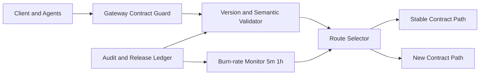

# Agent API Schema Drift Burn-rate 选型 FAQ（Cycle 1864）

## 1) 3 分钟结论
- **核心问题：** Agent 多模型与多工具编排下，API schema 漂移会在高峰期触发错误突增。
- **推荐方案：** “契约分层 + 漂移燃尽率（burn-rate）告警 + 自动降级路由”三联动。
- **目标：** 在不中断业务的前提下，把 schema 漂移从故障源变成可治理风险源。

## 2) Q1 / Q2 / Q3
### Q1：为什么只做版本号校验不够？
1) 同版本内字段可选性变化也会破坏兼容；
2) 工具链输出常带隐式 schema 偏移；
3) 多租户环境中灰度节奏不一致。

### Q2：生产级应如何设计 schema drift 控制面？
- **契约分层：** transport schema / semantic schema / policy schema 分治；
- **burn-rate 指标：** 漂移错误速率对比预算窗口（5m/1h）；
- **自动路由：** 超阈值时切换到稳定契约路径或强制 JSON mode；
- **追踪闭环：** 漂移事件与变更单、发布波次绑定。

### Q3：如何判定可上线？
- 漂移告警触发后能在预算窗口内降噪；
- 降级路由触发后 P95 延迟可控；
- 漂移事件可追溯至具体变更批次。

## 3) 架构图

## 4) 选型矩阵
| 维度 | 仅版本号校验 | 分层契约 + burn-rate（推荐） |
|---|---:|---:|
| 漂移发现粒度 | 低 | 高 |
| 爆发期稳定性 | 低 | 高 |
| 运维可观测性 | 中 | 高 |
| 实施复杂度 | 低 | 中 |
| 变更可追溯性 | 低 | 高 |

## 5) 证据与复算口径
- 证据文件：
  - `workshops/azure-agent-infra/evidence/cycle-1864-benchmark.json`
  - `workshops/azure-agent-infra/evidence/cycle-1864-latency.csv`
  - `workshops/azure-agent-infra/evidence/cycle-1864-throughput.csv`
  - `workshops/azure-agent-infra/evidence/cycle-1864-policy.csv`
- 标签：`measured / synthetic / anonymized_reported`。
- validation7：六段结构、7-card CSP、cycle-topic 绑定、可回放验证链。

## 6) 生产检查清单
- [ ] 分层契约检查点已注入网关与执行层。
- [ ] burn-rate 告警阈值与预算窗口已压测。
- [ ] 自动降级路由开关已完成演练。
- [ ] 漂移事件与发布批次映射可查询。
- [ ] FAQ/H5/SVG/7-card/evidence 轮次一致。
