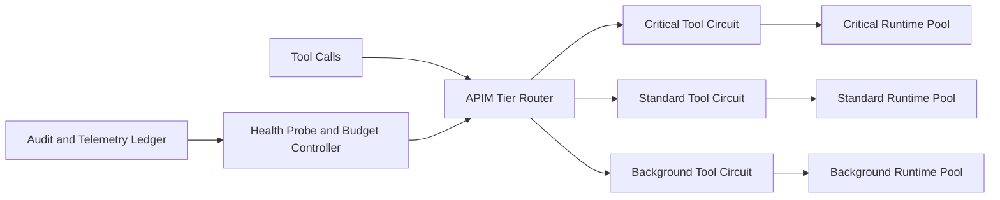

# APIM Circuit Tiering for Tools Selection FAQ (Cycle 1878)

## 1) Three-minute decision
- **Core issue:** a single circuit breaker can over-cut all tool paths, causing critical and low-priority tools to fail together.
- **Recommendation:** tiered circuits, tool-family isolation, and staged self-heal probing windows.
- **Goal:** keep critical tool availability during downstream instability while containing blast radius.

## 2) Q1 / Q2 / Q3
### Q1: Why is one breaker insufficient for multi-tool traffic?
1) failure domains differ by tool dependency,
2) uniform thresholds can penalize high-value tools,
3) unsynced recovery windows create oscillation.

### Q2: How should production circuit tiering be designed?
- **Tiered circuits:** independent thresholds by tool family/criticality,
- **Failure isolation:** high-risk failures stay out of critical paths,
- **Self-heal probing:** staged half-open recovery by tier,
- **Budget coupling:** co-tune with concurrency and timeout policies.

### Q3: What is the go-live bar?
- critical tool availability stays within target during failures,
- failure blast radius is materially reduced,
- post-recovery oscillation and retry storms remain controlled.

## 3) Reference architecture

## 4) Decision matrix
| Dimension | Single breaker | Tiered circuits (Recommended) |
|---|---:|---:|
| Critical-path availability | Medium | High |
| Failure isolation | Low | High |
| Recovery smoothness | Low | High |
| Implementation complexity | Low | Medium |
| Observability | Medium | High |

## 5) Evidence and reproducibility
- Evidence files:
  - `workshops/azure-agent-infra/evidence/cycle-1878-benchmark.json`
  - `workshops/azure-agent-infra/evidence/cycle-1878-latency.csv`
  - `workshops/azure-agent-infra/evidence/cycle-1878-throughput.csv`
  - `workshops/azure-agent-infra/evidence/cycle-1878-policy.csv`
- Labels: `measured / synthetic / anonymized_reported`.
- validation7 enforces six-part structure, CSP-safe 7-card output, strict cycle-topic alignment, and replayable checks.

## 6) Production checklist
- [ ] Tiered breaker thresholds are calibrated by tool family.
- [ ] Failure-isolation boundaries pass stress tests.
- [ ] Half-open self-heal probes pass drills.
- [ ] Circuit parameters are co-tuned with budget/timeout policies.
- [ ] FAQ/H5/SVG/7-card/evidence remain cycle-consistent.
