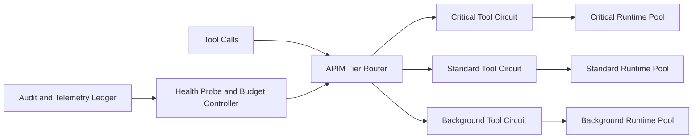

# APIM Circuit Tiering for Tools 选型 FAQ（Cycle 1878）

## 1) 3 分钟结论
- **核心问题：** 工具链路统一熔断容易“一刀切”，导致关键工具与低优先级工具共振失败。
- **推荐方案：** “分层熔断（tiered circuit）+ 工具族隔离 + 自愈探测窗口”架构。
- **目标：** 在下游不稳定时优先保障关键工具可用，同时限制故障扩散。

## 2) Q1 / Q2 / Q3
### Q1：为什么单一熔断器不适合多工具场景？
1) 工具依赖差异大，故障域并不一致；
2) 统一阈值会误伤高价值工具；
3) 恢复窗口不同步会触发反复抖动。

### Q2：生产级 circuit tiering 如何设计？
- **分层熔断：** 按工具族和关键级定义独立熔断阈值；
- **故障隔离：** 高风险工具故障不外溢到核心链路；
- **自愈探测：** 半开窗口按分层探测逐步恢复；
- **预算联动：** 与并发预算和超时策略协同调参。

### Q3：上线判据是什么？
- 关键工具可用性在故障期保持达标；
- 故障扩散范围明显缩小；
- 熔断恢复后的抖动与重试风暴受控。

## 3) 架构图

## 4) 选型矩阵
| 维度 | 单一熔断器 | 分层熔断（推荐） |
|---|---:|---:|
| 关键路径可用性 | 中 | 高 |
| 故障隔离能力 | 低 | 高 |
| 恢复平滑性 | 低 | 高 |
| 实施复杂度 | 低 | 中 |
| 可观测性 | 中 | 高 |

## 5) 证据与复算口径
- 证据文件：
  - `workshops/azure-agent-infra/evidence/cycle-1878-benchmark.json`
  - `workshops/azure-agent-infra/evidence/cycle-1878-latency.csv`
  - `workshops/azure-agent-infra/evidence/cycle-1878-throughput.csv`
  - `workshops/azure-agent-infra/evidence/cycle-1878-policy.csv`
- 标签：`measured / synthetic / anonymized_reported`。
- validation7：六段结构、7-card CSP、cycle-topic 对齐、验证链可回放。

## 6) 生产检查清单
- [ ] 工具族分层熔断阈值完成校准。
- [ ] 故障隔离边界压测通过。
- [ ] 半开自愈探测窗口演练通过。
- [ ] 熔断参数与预算/超时策略联调通过。
- [ ] FAQ/H5/SVG/7-card/evidence 轮次一致。
