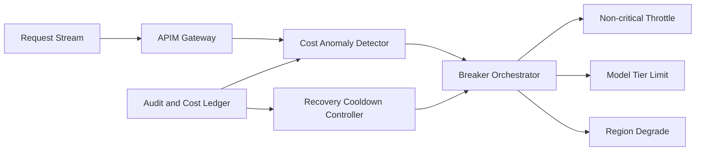

# APIM Cost-Anomaly Breaker Selection FAQ (Cycle 1856)

## 1) Three-minute decision
- **Core tradeoff:** cost anomalies require rapid loss containment, but false breaker triggers can harm availability and business continuity.
- **Recommendation:** multi-signal anomaly detection with tiered breaker actions and controlled recovery replay.
- **Goal:** cap financial exposure during cost spikes while preserving critical request continuity.

## 2) Q1 / Q2 / Q3
### Q1: Why is single-threshold global breaking risky?
1) short traffic spikes can create false alarms,
2) no separation between critical and noncritical traffic increases business impact,
3) lack of replay validation causes oscillating recoveries.

### Q2: What production-grade cost-anomaly breaker strategy should be used?
- **Multi-signal detection:** token unit-price drift, request-cost slope, and abnormal-tenant ratio,
- **Tiered breaker:** throttle noncritical lanes, then cap expensive model tiers, then regional degrade,
- **Recovery:** gradual restoration after cooldown windows,
- **Audit loop:** trace every break/recover action to ledger records.

### Q3: How do we validate stable and accurate breaker behavior?
- bounded cost loss during anomaly windows,
- critical-path success rate remains in target bands,
- lower false-trigger ratio and recovery oscillation count.

## 3) Reference architecture

## 4) Decision matrix
| Dimension | Single-threshold global breaker | Multi-signal tiered breaker (Recommended) |
|---|---:|---:|
| Loss-containment precision | Low | High |
| Availability protection | Low | High |
| False-trigger control | Low | High |
| Implementation complexity | Low | Medium |
| Recoverability | Low | High |

## 5) Evidence and reproducibility
- Evidence files:
  - `workshops/azure-agent-infra/evidence/cycle-1856-benchmark.json`
  - `workshops/azure-agent-infra/evidence/cycle-1856-latency.csv`
  - `workshops/azure-agent-infra/evidence/cycle-1856-throughput.csv`
  - `workshops/azure-agent-infra/evidence/cycle-1856-policy.csv`
- Labels: `measured / synthetic / anonymized_reported`.
- validation7 enforces bilingual six-part structure, CSP self-contained 7-card output, strict cycle-evidence alignment, and replayability.

## 6) Production checklist
- [ ] Multi-signal anomaly rules are frozen.
- [ ] Tiered breaker actions and priorities are integrated.
- [ ] Cooldown and staged recovery replay are validated.
- [ ] Break/recover audit ledger is traceable.
- [ ] FAQ/H5/SVG/7-card align with cycle evidence.
