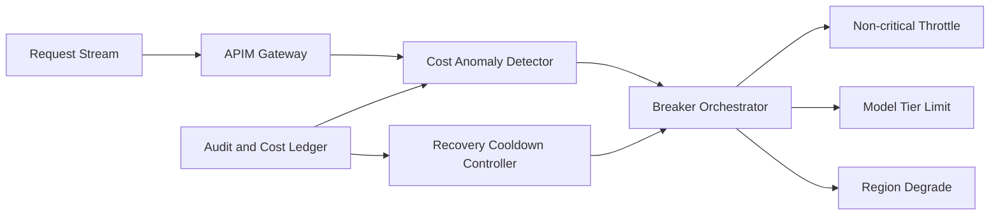

# APIM 成本异常熔断选型 FAQ（Cycle 1856）

## 1) 3 分钟结论
- **核心矛盾：** 成本异常必须快速止损，但误触发熔断会伤害可用性与业务连续性。
- **推荐：** 多信号成本异常检测 + 分级熔断动作 + 可恢复灰度回放。
- **目标：** 在突发费用异常时限制损失，同时保障关键请求连续服务。

## 2) Q1 / Q2 / Q3
### Q1：为什么“单阈值超额即全局熔断”风险高？
1) 短时流量峰值可能触发误报；
2) 不区分关键/非关键流量会放大业务损失；
3) 缺少回放验证会导致反复抖动切换。

### Q2：生产级成本异常熔断策略如何设计？
- **多信号检测：** token 单价偏移、请求成本斜率、租户异常占比联合判断；
- **分级熔断：** 先收紧非关键流量，再限制高成本模型，最后区域级降载；
- **恢复机制：** 进入冷却窗口后按灰度比例逐步恢复；
- **审计闭环：** 每次熔断/恢复均写入可追溯账本。

### Q3：如何验证熔断策略“稳且准”？
- 异常期间成本损失上限可控；
- 关键路径成功率在目标区间；
- 误触发率和恢复抖动次数下降。

## 3) 架构图

## 4) 选型矩阵
| 维度 | 单阈值全局熔断 | 多信号分级熔断（推荐） |
|---|---:|---:|
| 止损精度 | 低 | 高 |
| 可用性保护 | 低 | 高 |
| 误触发控制 | 低 | 高 |
| 实施复杂度 | 低 | 中 |
| 可恢复性 | 低 | 高 |

## 5) 证据与复算口径
- 证据文件：
  - `workshops/azure-agent-infra/evidence/cycle-1856-benchmark.json`
  - `workshops/azure-agent-infra/evidence/cycle-1856-latency.csv`
  - `workshops/azure-agent-infra/evidence/cycle-1856-throughput.csv`
  - `workshops/azure-agent-infra/evidence/cycle-1856-policy.csv`
- 标签：`measured / synthetic / anonymized_reported`。
- validation7：双语六段结构、7-card CSP 自包含、轮次与 evidence 一致、可回放链路通过。

## 6) 生产检查清单
- [ ] 多信号成本异常规则已冻结。
- [ ] 分级熔断动作与优先级联调通过。
- [ ] 恢复冷却与灰度回放策略可演练。
- [ ] 熔断/恢复审计账本可追溯。
- [ ] FAQ/H5/SVG/7-card 与 evidence 轮次一致。
