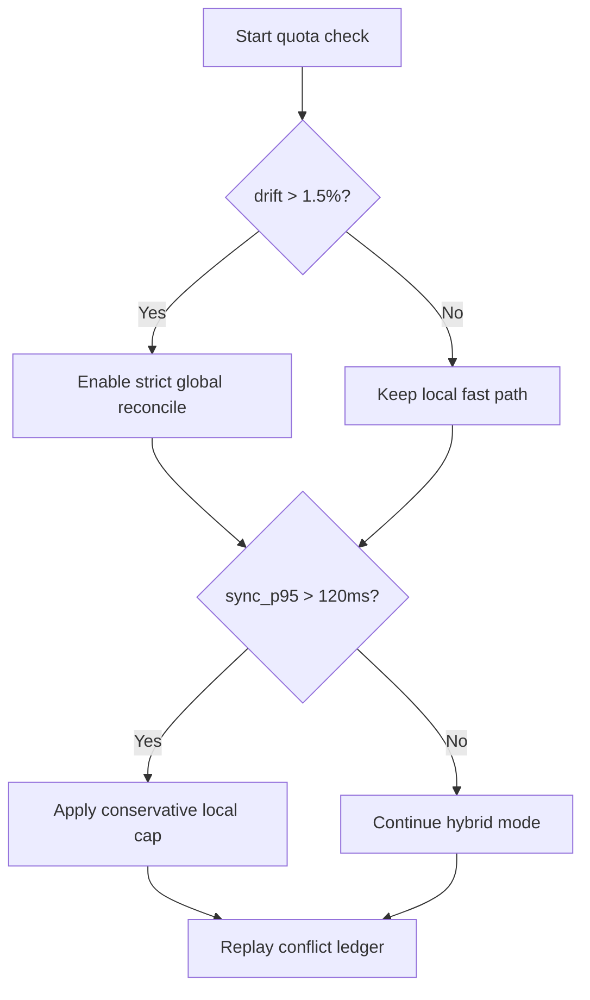
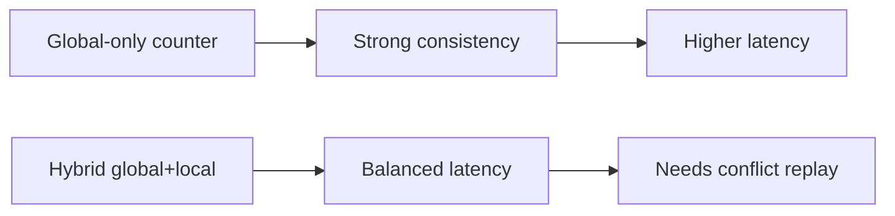
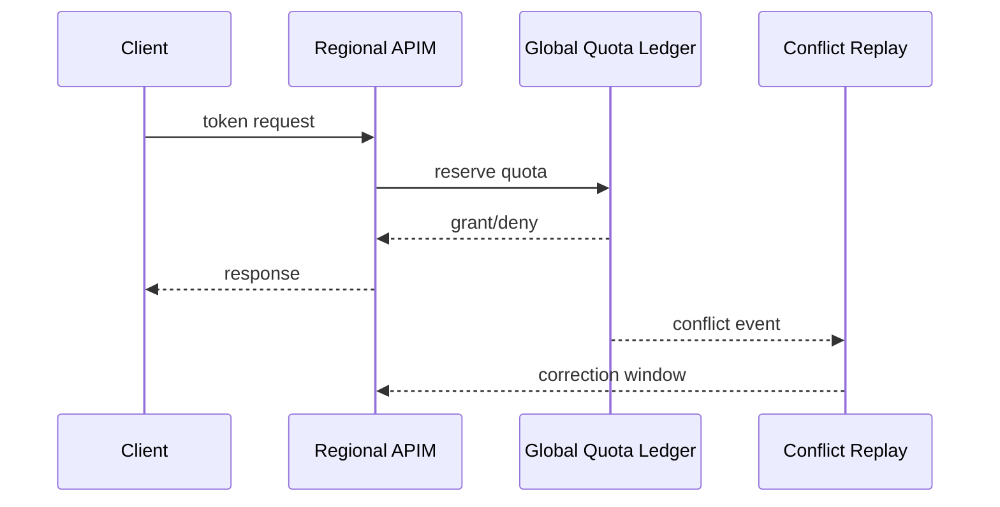

# Agent APIM Cross-Region Token-Limit Consistency Selection FAQ (Azure AI Agent Infra)

## 1) 3-minute conclusions
- **Without consistency controls, cross-region APIM AI Gateway token limits drift and over/under-enforce quotas.**
- **Recommended pattern: global quota ledger + regional fast cache in a hybrid model.**
- **Targets: `quota_drift <1.5%`, `global_sync_p95 <120ms`, `false_reject <0.3%`.**

## 2) Q1 / Q2 / Q3
- **Why quota oversell happens?** Regional counters diverge under concurrent bursts.
- **Why not global-only counter?** It raises latency and hurts hotspot throughput.
- **Minimum loop?** Local reservation + global settle + conflict replay.

### Q1: When to trigger strict mode?
When cross-region drift breaches threshold continuously.

### Q2: When to degrade?
When global ledger latency spikes; switch to conservative local caps.

### Q3: How to evaluate gain?
Compare false reject, oversell, and throughput.

## 3) Mermaid diagrams
### 3.1 Decision tree

### 3.2 Path comparison

### 3.3 Sequence

## 4) Decision matrix
| Dimension | Global-only counter | Hybrid dual-layer (Recommended) |
|---|---:|---:|
| Consistency | High | High |
| Latency | Medium-low | Medium-high |
| Throughput | Medium | High |
| Ops complexity (1-10) | 5 | 8 |
| False reject control | Medium | High |

## 5) Quant model + 7-card insights
- Drift rate: `Drift = |RegionalUsed - GlobalUsed| / GlobalUsed`
- Protection gain: `RejectGain = BaselineFalseReject - HybridFalseReject`
- Example (`synthetic_assumed`):
  - `RegionalUsed=1,012,000, GlobalUsed=1,000,000`
  - `Drift=1.2%`
  - `BaselineFalseReject=0.9%, HybridFalseReject=0.26%`
  - `RejectGain=0.64%`
- Evidence:
  - `workshops/azure-agent-infra/evidence/cycle-1470-benchmark.json`
  - `workshops/azure-agent-infra/evidence/cycle-1470-sources.json`
- Labels: `official/synthetic_assumed/not_measured`.

## 6) Production verification checklist
- [ ] Global ledger SLA and timeout fallback policy defined
- [ ] Regional reservation and conflict replay enabled
- [ ] drift/false_reject alerts are traceable
- [ ] Cross-region drill scripts are reproducible
- [ ] FAQ/7-card source labels are complete
