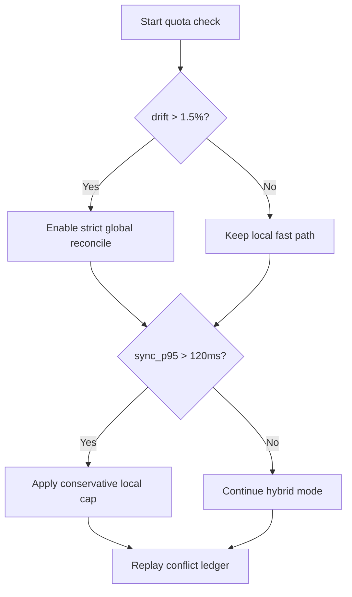
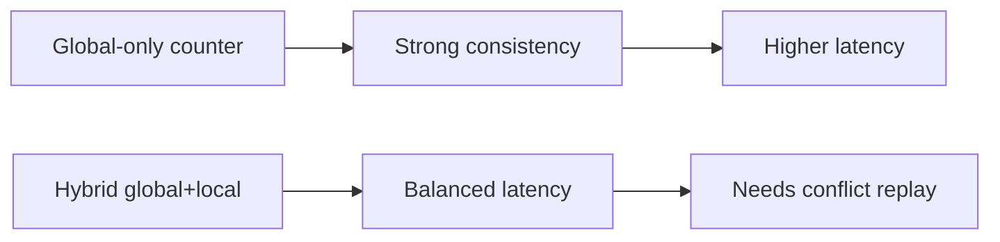
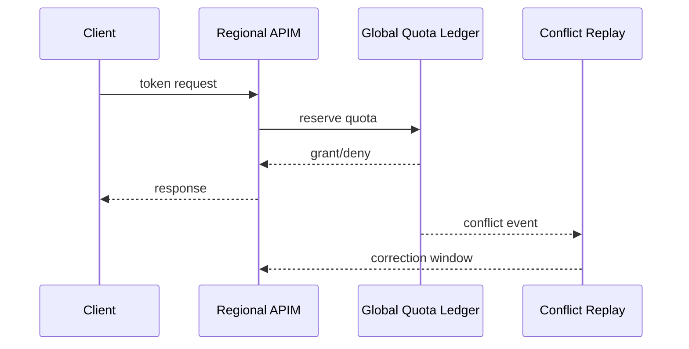

# Agent APIM Cross-Region Token-Limit Consistency 选型 FAQ（Azure AI Agent Infra）

## 1) 3 分钟结论
- **跨区 APIM AI Gateway 的 token 速率限制若无一致性同步，会导致区域间限流漂移。**
- **推荐全局配额账本 + 区域本地快速缓存双层策略。**
- **阈值建议：`quota_drift <1.5%`、`global_sync_p95 <120ms`、`false_reject <0.3%`。**

## 2) Q1 / Q2 / Q3
- **为何会超卖配额？**：多区并发下本地计数器未及时汇总。
- **为何不能只用中心化计数？**：延迟高，热点租户会拉低吞吐。
- **最小闭环？**：本地预扣 + 全局结算 + 冲突回放。

### Q1：何时触发保护？
当跨区账本偏差率持续超过门限。

### Q2：何时降级？
当全局账本延迟异常，切本地保守阈值。

### Q3：收益如何看？
对比误拒率、超卖率与吞吐。

## 3) Mermaid 图
### 3.1 决策树

### 3.2 路径对比

### 3.3 时序

## 4) 决策矩阵
| 维度 | 全局单计数 | 双层混合（推荐） |
|---|---:|---:|
| 一致性 | 高 | 高 |
| 延迟 | 低-中 | 中高 |
| 吞吐 | 中 | 高 |
| 运维复杂度（1-10） | 5 | 8 |
| 误拒控制 | 中 | 高 |

## 5) 定量算例与 7-Card 洞察
- 偏差率：`Drift = |RegionalUsed - GlobalUsed| / GlobalUsed`
- 保护收益：`RejectGain = BaselineFalseReject - HybridFalseReject`
- 示例（`synthetic_assumed`）：
  - `RegionalUsed=1,012,000, GlobalUsed=1,000,000`
  - `Drift=1.2%`
  - `BaselineFalseReject=0.9%, HybridFalseReject=0.26%`
  - `RejectGain=0.64%`
- 证据：
  - `workshops/azure-agent-infra/evidence/cycle-1470-benchmark.json`
  - `workshops/azure-agent-infra/evidence/cycle-1470-sources.json`
- 标签：`official/synthetic_assumed/not_measured`。

## 6) 生产核验 Checklist
- [ ] 全局账本 SLA 与超时降级策略已定义
- [ ] 区域本地预扣与冲突回放启用
- [ ] drift/false_reject 指标告警可追溯
- [ ] 跨区故障演练脚本可复现
- [ ] FAQ/7-Card 来源标签完整
