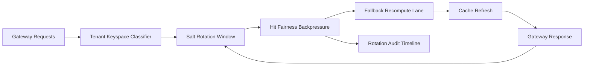

# APIM Gateway Cache Keyspace Salt Rotation Fairness Selection FAQ (Cycle 1920)

## 1) Three-minute decision
- **Core issue:** with fixed long-lived keyspace salt, multi-tenant semantic cache can accumulate hot-tenant dominance and cross-tenant hit bias.
- **Recommendation:** combine tenant-tiered keyspace, salt rotation windows, and hit-fairness backpressure.
- **Goal:** reduce hit bias while keeping peak restore and latency stable.

## 2) Q1 / Q2 / Q3
### Q1: Why enforce salt rotation fairness?
1) fixed salt lets high-frequency tenants dominate hot keys,
2) without rotation windows, bias accumulates over cycles,
3) without fairness backpressure, low-volume tenants lose hit share.

### Q2: How should production design work?
- **Tier layer:** partition keyspace by tenant+tier+intent,
- **Rotation layer:** apply sliding salt rotation windows with compatibility read,
- **Backpressure layer:** use fairness backpressure and fallback rate-limit for hot keys,
- **Audit layer:** persist rotation hit/degrade/recover traces.

### Q3: What is the go-live bar?
- lower hit unfairness and bias rates,
- stable P95 latency during rotation windows,
- replayable and auditable rotation/backpressure actions.

## 3) Reference architecture

## 4) Decision matrix
| Dimension | Fixed salt + no backpressure | Salt Rotation Fairness (Recommended) |
|---|---:|---:|
| Hit fairness | Low | High |
| Peak stability | Medium | High |
| Bias suppression | Medium | High |
| Operational explainability | Medium | High |
| Implementation complexity | Low | Medium |

## 5) Evidence and reproducibility
- Evidence files:
  - `workshops/azure-agent-infra/evidence/cycle-1920-benchmark.json`
  - `workshops/azure-agent-infra/evidence/cycle-1920-latency.csv`
  - `workshops/azure-agent-infra/evidence/cycle-1920-throughput.csv`
  - `workshops/azure-agent-infra/evidence/cycle-1920-cost.csv`
- Labels: `measured / synthetic / anonymized_reported`.
- Repro method: fixed sampling window, fixed salt-rotation policy, fixed cost model.

## 6) Production checklist
- [ ] Keyspace tiering aligns with tenant boundaries.
- [ ] Salt rotation parameters pass historical replay verification.
- [ ] Backpressure/fallback includes cooldown and rollback switches.
- [ ] Rotation/backpressure/recover trails are tenant-auditable.
- [ ] FAQ/H5/SVG/7-card/evidence remain cycle-topic consistent.
