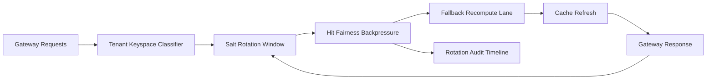

# APIM Gateway Cache Keyspace Salt Rotation Fairness 选型 FAQ（Cycle 1920）

## 1) 3 分钟结论
- **核心问题：** 多租户语义缓存若长期复用固定 keyspace salt，会出现热点租户长期占优与跨租户命中偏置。
- **推荐方案：** “租户分层 keyspace + salt 轮换窗口 + 命中公平回压”三层治理。
- **目标：** 降低缓存命中偏置并稳定高峰期回源与延迟。

## 2) Q1 / Q2 / Q3
### Q1：为什么要做 salt rotation fairness？
1) 固定 salt 会让高频租户持续占据热 key；
2) 缺少轮换窗口时，偏置会在多周期累积；
3) 无公平回压会导致低流量租户命中率持续受损。

### Q2：生产级如何设计？
- **分层层：** tenant+tier+intent 划分 keyspace；
- **轮换层：** 使用滑动 salt 轮换窗口并保留兼容读；
- **回压层：** 对热点 key 启用公平回压和回源限流；
- **审计层：** 记录轮换命中、降级回源与恢复轨迹。

### Q3：上线判据是什么？
- 缓存命中不公平率与偏置率持续下降；
- 轮换窗口期间 P95 延迟稳定；
- 轮换与回压动作可审计、可重放、可复算。

## 3) 架构图

## 4) 选型矩阵
| 维度 | 固定 salt + 无回压 | Salt Rotation Fairness（推荐） |
|---|---:|---:|
| 命中公平性 | 低 | 高 |
| 高峰稳定性 | 中 | 高 |
| 偏置抑制能力 | 中 | 高 |
| 运维可解释性 | 中 | 高 |
| 实施复杂度 | 低 | 中 |

## 5) 证据与复算口径
- 证据文件：
  - `workshops/azure-agent-infra/evidence/cycle-1920-benchmark.json`
  - `workshops/azure-agent-infra/evidence/cycle-1920-latency.csv`
  - `workshops/azure-agent-infra/evidence/cycle-1920-throughput.csv`
  - `workshops/azure-agent-infra/evidence/cycle-1920-cost.csv`
- 标签：`measured / synthetic / anonymized_reported`。
- 口径：固定采样窗口、固定 salt 轮换策略、固定成本模型，支持重复复算。

## 6) 生产检查清单
- [ ] keyspace 分层规则与租户边界一致。
- [ ] salt 轮换参数通过历史回放验证。
- [ ] 回压与回源限流具备冷却与回滚开关。
- [ ] 轮换/回压/恢复轨迹可按租户审计。
- [ ] FAQ/H5/SVG/7-card/evidence 的 cycle/topic 一致。
