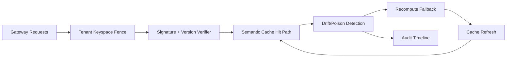

# APIM Gateway Cache Poisoning Tenant Fence Selection FAQ (Cycle 1916)

## 1) Three-minute decision
- **Core issue:** in shared multi-tenant semantic cache paths, missing tenant fences allows cache-poisoning spread across tenants.
- **Recommendation:** combine tenant keyspace fencing, hit-integrity signatures, and recompute fallback.
- **Goal:** minimize cross-tenant contamination while preserving freshness and latency stability.

## 2) Q1 / Q2 / Q3
### Q1: Why enforce tenant fences?
1) shared key logic amplifies contamination by noisy tenants,
2) without integrity checks, stale/poisoned hits are hard to detect,
3) without fallback recompute, bad hits persist.

### Q2: How should production design work?
- **Keyspace layer:** enforce tenant+scenario+policy strong keys,
- **Integrity layer:** verify signature and version stamp before hit use,
- **Fallback layer:** trigger recompute and refresh on hit anomaly,
- **Audit layer:** persist poisoning events, denials, and recovery trail.

### Q3: What is the go-live bar?
- lower cross-tenant poisoned-hit rate,
- stable anomaly-detect and fallback-recovery latency,
- replayable and explainable fence/fallback actions.

## 3) Reference architecture

## 4) Decision matrix
| Dimension | Cache without tenant fence | Tenant Fence Governance (Recommended) |
|---|---:|---:|
| Cross-tenant contamination control | Low | High |
| Hit integrity | Low | High |
| Fallback recovery stability | Medium | High |
| Operational explainability | Medium | High |
| Implementation complexity | Low | Medium |

## 5) Evidence and reproducibility
- Evidence files:
  - `workshops/azure-agent-infra/evidence/cycle-1916-benchmark.json`
  - `workshops/azure-agent-infra/evidence/cycle-1916-latency.csv`
  - `workshops/azure-agent-infra/evidence/cycle-1916-throughput.csv`
  - `workshops/azure-agent-infra/evidence/cycle-1916-cost.csv`
- Labels: `measured / synthetic / anonymized_reported`.
- Repro method: fixed sampling window, fixed fence policy, fixed cost model.

## 6) Production checklist
- [ ] Tenant keyspace policy aligns with isolation boundaries.
- [ ] Signature/version checks pass historical replay.
- [ ] Fallback recompute includes cooldown and rollback switches.
- [ ] Poison-hit and recovery trails are tenant-auditable.
- [ ] FAQ/H5/SVG/7-card/evidence remain cycle-topic consistent.
