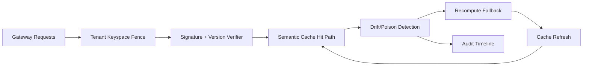

# APIM Gateway Cache Poisoning Tenant Fence 选型 FAQ（Cycle 1916）

## 1) 3 分钟结论
- **核心问题：** 多租户网关共享语义缓存时，若缺少租户隔离栅栏，缓存投毒会沿命中路径跨租户扩散。
- **推荐方案：** “租户键空间栅栏 + 命中完整性签名 + 异常回源重算”三层治理。
- **目标：** 降低跨租户污染半径并稳定命中新鲜度与调用延迟。

## 2) Q1 / Q2 / Q3
### Q1：为什么要做 tenant fence？
1) 共享 key 规则容易被高频租户放大污染；
2) 无签名校验时陈旧或污染命中难以及时识别；
3) 缺少回源重算会让异常命中持续扩散。

### Q2：生产级如何设计？
- **键空间层：** 以 tenant+scenario+policy 形成强隔离 key；
- **完整性层：** 命中前校验签名与版本戳；
- **回源层：** 命中异常立即走回源重算并刷新缓存；
- **审计层：** 记录污染事件、命中拒绝与恢复轨迹。

### Q3：上线判据是什么？
- 跨租户污染命中率持续下降；
- 异常命中检测与回源恢复时延稳定；
- 栅栏与回源动作可回放、可解释、可复算。

## 3) 架构图

## 4) 选型矩阵
| 维度 | 无租户栅栏缓存 | Tenant Fence Governance（推荐） |
|---|---:|---:|
| 跨租户污染控制 | 低 | 高 |
| 命中完整性 | 低 | 高 |
| 回源恢复稳定性 | 中 | 高 |
| 运维可解释性 | 中 | 高 |
| 实施复杂度 | 低 | 中 |

## 5) 证据与复算口径
- 证据文件：
  - `workshops/azure-agent-infra/evidence/cycle-1916-benchmark.json`
  - `workshops/azure-agent-infra/evidence/cycle-1916-latency.csv`
  - `workshops/azure-agent-infra/evidence/cycle-1916-throughput.csv`
  - `workshops/azure-agent-infra/evidence/cycle-1916-cost.csv`
- 标签：`measured / synthetic / anonymized_reported`。
- 口径：固定采样窗口、固定栅栏规则、固定成本模型，支持重复复算。

## 6) 生产检查清单
- [ ] 租户键空间规则与业务隔离边界一致。
- [ ] 签名/版本校验通过历史回放验证。
- [ ] 回源重算链路具备冷却与回滚开关。
- [ ] 污染命中与恢复轨迹可按租户审计。
- [ ] FAQ/H5/SVG/7-card/evidence 的 cycle/topic 一致。
